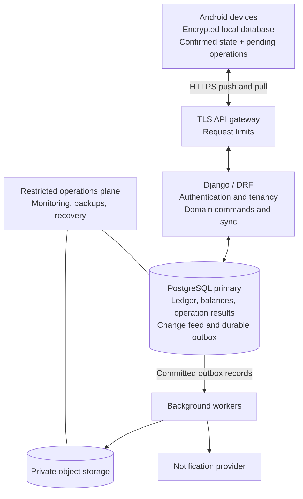

OpenAI Codex v0.162.0
--------
workdir: /mnt/f/personal projects/credkeep
model: gpt-6.1-sol
provider: openai
approval: never
sandbox: read-only
reasoning effort: none
reasoning summaries: none
session id: 01a12457-3755-7d62-b8f7-e2cf34a2b167
--------
user
Based on the CredKeep V2 product requirements in the user prompt, please propose an independent V2 architecture for the Django/DRF backend, multi-tenant database, threat model, and the offline-to-online sync protocol. Focus on the core system topology and the fundamental challenges. Output your proposal as a technical markdown document.

warning: Codex could not find bubblewrap on PATH. Install bubblewrap with your OS package manager. See the sandbox prerequisites: https://developers.openai.com/codex/concepts/sandboxing#prerequisites. Codex will use the bundled bubblewrap in the meantime.
codex
I’ll read the project’s workflow state and available V2 requirements, then draft an independent architecture proposal covering tenancy, security, and offline sync.

exec
/bin/bash -lc 'cat AGENTS.md .workflow/STATE.md' in /mnt/f/personal projects/credkeep
 succeeded in 0ms:
This is an Expo/React Native mobile application. Prioritize mobile-first patterns, performance, and cross-platform compatibility.

## Expo has changed — do not trust your training data

Expo ships breaking changes every SDK release. APIs you remember are likely renamed, moved, or removed. Before writing any code that touches an Expo, EAS, or React Native API:

1. Read the major version of the `expo` package in `package.json`.
2. Fetch the matching versioned docs: `https://docs.expo.dev/versions/v<major>.0.0/`
3. For anything else, fetch https://docs.expo.dev/llms.txt — an index of all Expo docs with corrections to common LLM misconceptions. Follow its links to the specific page you need; never answer from memory.

## Commands

Use `bunx` instead of `npx` if the project uses bun (`bun.lock` present).

```bash
npx expo install <package>  # ALWAYS use instead of npm/yarn/pnpm/bun add — resolves SDK-compatible versions
npx expo start              # start the dev server
npx expo lint               # lint
npx tsc --noEmit            # typecheck
npx expo-doctor             # diagnose dependency and config issues
npx expo install --fix      # fix incompatible package versions
```

Run lint and typecheck before declaring any task done.

## Navigation & Routing

- Use **Expo Router** for all navigation. Routes live in `src/app/` — every file there is a screen, `_layout.tsx` files define navigators. Keep non-route code (components, hooks, utils) outside `src/app/`.
- Import `Link`, `router`, and `useLocalSearchParams` from `expo-router`.
- Docs: https://docs.expo.dev/router/introduction.md

## Building with EAS

Use EAS to build, sign, and submit the app in the cloud (`eas build`, `eas submit`) and to ship over-the-air updates (`eas update`) — no local Xcode or Android Studio required. Run EAS CLI as `bunx eas-cli <command>` in Bun projects, or `npx eas-cli@latest <command>` otherwise; substitute that for bare `eas` in docs examples.
Docs: https://docs.expo.dev/eas/index.md

## Rules

- If `ios/` and `android/` directories do not exist, they are generated (Continuous Native Generation). Never create or edit them by hand — configure native behavior in `app.json` and config plugins.
- Expo Go only includes its bundled native modules. After adding a library with native code, the app needs a development build: `npx expo run:ios|android` locally, or `eas build --profile development`.
- Prefer recommended Expo modules over third-party libraries, and check your available skills before adding dependencies. Docs: https://docs.expo.dev/versions/latest/index.md

## Agent skills

### Issue tracker

Local markdown issues live in `.scratch/<feature>/`. See `docs/agents/issue-tracker.md`.

### Triage labels

Five canonical roles using default labels (`needs-triage`, `needs-info`, `ready-for-agent`, `ready-for-human`, `wontfix`). See `docs/agents/triage-labels.md`.

### Domain docs

Single-context layout (`GLOSSARY.md` and `docs/adr/` at repo root). See `docs/agents/domain.md`.

## Autonomous Development Workflow

CredKeep operates under an autonomous AI-driven development model where the user acts solely as Product Owner. Agents must autonomously write code, select skills, run validation commands, and create local Git commits without burdening the Product Owner with manual operational prompts.

### Automatic Skill Selection Rules

Select skills autonomously based on the specific engineering task:
- **Financial Math & Ledger Engine**: Auto-select `tdd` for test-first implementation of money arithmetic, schedule generators, overdue periods, and allocation waterfalls.
- **Architecture & Boundaries**: Auto-select `setup-ts-deep-modules` when defining TypeScript interfaces, domain contracts, and encapsulated module barriers.
- **Spec Execution**: Auto-select `implement-spec` when claiming and implementing tickets from `.scratch/<feature>/issues/`.
- **Domain Alignment**: Auto-select `domain-modeling` when introducing or reconciling domain terms against `GLOSSARY.md` and `docs/adr/`.
- **Pre-Commit Verification**: Auto-select `code-review` to inspect diffs against domain invariants before committing.
- **UI Screen Construction**: Consult Stitch MCP design assets (`CredKeep V1 — Mobile Design System`, Project ID `8106667901868227815`, Expected screens: 11) for screen layouts, typography, and color tokens. NEVER use the old `CredKeep Field Lending App` project.

### Automated Local Git Workflow

Execute Git operations locally and autonomously under these invariants:
1. **Preserve Working Changes**: Inspect `git status` prior to branch transitions; preserve working changes cleanly.
2. **Scoped Feature Branches**: Create scoped branches for tickets (`feat/<feature-slug>/<ticket-slug>`).
3. **Mandatory Quality Gates**:
   - Run type checks (`npx tsc --noEmit`).
   - Run linter (`npx expo lint` or configured linter).
   - Run tests (`npm test` once configured).
   - If any check fails, resolve the issue autonomously before attempting to commit.
4. **Selective Staging**: Stage only files relevant to the specific ticket (`git add <paths>`). Never stage unrelated files or secrets.
5. **Conventional Commits**: Automatically author descriptive Conventional Commit messages (`feat(...)`, `fix(...)`, `test(...)`, `refactor(...)`, `docs(...)`).
6. **Report Commit Hash**: Always report the created commit hash and summary to the Product Owner.
7. **Strict Non-Destructive Boundary**:
   - **NEVER** automatically push to remote (`git push`).
   - **NEVER** force-push (`git push --force`).
   - **NEVER** delete branches without explicit Product Owner approval.

### Agent Permissions & Boundaries

- **Autonomous (Permitted Without Asking)**:
  - Reading, searching, and viewing project files.
  - Running safe `git status`, `git log`, and `git diff` commands.
  - Creating, editing, and formatting project source files.
  - Running development quality gates (`npx tsc --noEmit`, `npx expo lint`, `npm test`, `npx expo-doctor`).
  - Running safe local diagnostic scripts and repeating failed tests after code fixes.
  - Invoking the authenticated Codex CLI for planning and independent QA in its noninteractive sandbox.
  - Running verified project-scoped Graphify commands.
  - Installing normal, necessary, compatible project development dependencies.
  - Creating task-specific local Git commits and staging selective changes.
  - Updating `.workflow` state, reports, and handoff documentation.
  - Transitioning between planning, implementation, testing, and code review autonomously.

- **Prohibited Without Explicit Approval**:
  - Deleting or resetting financial records.
  - Destructive Git operations (e.g., branch deletion, `push --force`).
  - Exposing or changing credentials.
  - Changing system-wide security settings.
  - Running untrusted scripts requiring elevated privileges.
  - Pushing code to remote repositories (GitHub/`origin`).
  - Publishing the app or triggering an EAS cloud build.
  - Bypassing operating-system security, fabricating approvals, or using unrestricted command execution to defeat safety controls.
  - Installing system-level software or machine packages.
  - Making paid services or purchases.

### Model Routing Policy

Antigravity operates on session-level model configuration (no per-step dynamic model switching). All autonomous tasks execute on the session's active strong model without simulating unsupported routing.

## Performance Is a Continuous Requirement

CredKeep is a lightweight, offline-first Android financial application.

Performance, efficient storage, and reasonable APK size are permanent engineering requirements, not optional V2 enhancements.

### 1. APK Size

- Investigate unnecessary native modules and bundled assets.
- Avoid adding dependencies when built-in React Native or Expo functionality is sufficient.
- Preserve SQLCipher and other required security features.
- Keep production JavaScript minification and compatible native shrinking enabled.
- Measure actual APK size after every approved release build.
- Compare each new artifact with the previous measured release.
- Investigate significant unexplained size increases.
- Never claim a particular APK size reduction without measuring it.
- Never compromise security or financial correctness merely to reduce APK size.

### 2. React Native Performance

- Avoid unnecessary component rerenders.
- Use FlatList or appropriate virtualized lists for potentially large borrower, loan, or transaction collections.
- Paginate lengthy histories.
- Avoid expensive calculations directly inside render functions.
- Use memoization where profiling or measurable behavior justifies it.
- Ensure loading, empty, and error states remain responsive.
- Avoid oversized image assets and unnecessary animation libraries.

### 3. SQLite Performance

- Add appropriate indexes for borrower_id, loan_id, due_date, status, and frequently queried transaction timestamps.
- Avoid N+1 queries in borrower and loan lists.
- Use transactions for financial mutations.
- Paginate long transaction histories.
- Measure query performance using realistic test datasets.
- Maintain correct journal and balance reconciliation.
- Never sacrifice accuracy or auditability for speed.

### 4. Startup & Memory

- Keep app startup lightweight.
- Initialize the database and security layer correctly.
- Avoid loading every historical transaction during application startup.
- Load screen-specific data when necessary.
- Clean up listeners and subscriptions.
- Avoid retaining redundant financial data in memory.

### 5. Offline & Battery Efficiency

- All V1 financial workflows must function without connectivity.
- Avoid unnecessary background polling.
- Use database mutation notifications or suitable state invalidation instead of continuous queries.
- Avoid unnecessary background tasks and battery-consuming refresh loops.

### 6. Dependency Discipline

Before installing a package:
- Verify that it is required.
- Check compatibility with the installed Expo SDK.
- Consider APK/native binary size implications.
- Prefer maintained packages.
- Avoid duplicate libraries performing the same job.

Do not remove a required dependency solely because it increases APK size.

### 7. Release Optimization Gate

Before requesting approval for a new EAS build:

- All critical business workflows must pass tests.
- TypeScript, ESLint, and Expo Doctor must pass.
- Check for unused dependencies and accidentally bundled development assets.
- Confirm appropriate release minification and resource shrinking.
- Confirm security and database functionality remain intact.
- Summarize any known performance concerns.

After an approved EAS build, report:

- Actual APK file size
- Build profile and Git commit
- APK architecture(s), if verified
- Startup performance, if measured
- Relevant performance regressions
- Prioritized optimization opportunities

Never invent benchmark results.

### 8. Optimization Priorities

Priority order:

1. Financial correctness and data integrity
2. Security
3. Functional offline workflows
4. UI responsiveness and Android stability
5. Battery and memory efficiency
6. APK size reduction
7. Cosmetic performance improvements

Do not perform broad architectural rewrites merely to reduce bundle size.

### 9. Automation

Apply these rules to every future CredKeep task automatically.

Use profiling and measurement before making invasive optimizations.

Perform safe, low-risk optimization during development.

Reserve intensive APK analysis and performance tuning for the final V1 stabilization phase.

## Multi-Agent Workflow Integration
This project uses a split-agent model:
- **Codex:** Planner, Tester, Reviewer. Operates independently.
- **Gemini / Antigravity:** Implementer and Orchestrator.

**Coordination Rules:**
1. All agents MUST read `.workflow/STATE.md` before taking action.
2. Agents MUST read `AGENTS.md` before every action.
3. Hand-offs occur by updating `.workflow/HANDOFF.md` and invoking the next agent.
4. Codex is the final arbiter of QA and tests.
5. All completed work MUST have local Git commits with conventional commit messages.

## graphify

This project has a knowledge graph at graphify-out/ with god nodes, community structure, and cross-file relationships.

When the user types `/graphify`, use the installed graphify skill or instructions before doing anything else.

Rules:
- For codebase questions, first run `graphify query "<question>"` when graphify-out/graph.json exists. Use `graphify path "<A>" "<B>"` for relationships and `graphify explain "<concept>"` for focused concepts. These return a scoped subgraph, usually much smaller than GRAPH_REPORT.md or raw grep output.
- Dirty graphify-out/ files are expected after hooks or incremental updates; dirty graph files are not a reason to skip graphify. Only skip graphify if the task is about stale or incorrect graph output, or the user explicitly says not to use it.
- If graphify-out/wiki/index.md exists, use it for broad navigation instead of raw source browsing.
- Read graphify-out/GRAPH_REPORT.md only for broad architecture review or when query/path/explain do not surface enough context.
- After modifying code, run `graphify update .` to keep the graph current (AST-only, no API cost).
# CredKeep Project State

## Current Context
- **Current Git Branch:** feat/bugfix/second-phone-install
- **HEAD Commit:** pending

## Active Task
- **Task ID:** Second-phone installation failure
- **Assigned Agent:** Gemini
- **Current Stage:** Completed

## Status
- **Known Failures:** None.
- **Latest Verified Test Results:** 35 passed
- **Next Action:** Await Product Owner's final approval for CredKeep V1.

exec
/bin/bash -lc "rg --files -g '*V2*' -g '*v2*' -g '*require*' -g '*PRD*' -g '*HANDOFF*' -g '*GLOSSARY*'; test -f graphify-out/graph.json && command -v graphify" in /mnt/f/personal projects/credkeep
 exited 1 in 177ms:
GLOSSARY.md

codex
The prompt available here does not include the V2 product requirements. Please paste them or identify their repository path; I’ll proceed with an explicitly marked baseline proposal while checking the available project context.
exec
/bin/bash -lc 'cat AGENTS.md >/dev/null; cat GLOSSARY.md; rg --files docs .scratch .workflow | head -70' in /mnt/f/personal projects/credkeep
 succeeded in 68ms:
# CredKeep Domain Glossary

Field lending ledger vocabulary for single-financier informal and semi-formal Indian credit systems.

## Language

### Monetary Units & Calculations

**Paise**:
The canonical integer monetary unit (1 INR = 100 Paise) used for all internal calculations, storage, and ledger operations to eliminate floating-point rounding errors.
_Avoid_: Rupees (in domain models), float, decimal

**Contractual Face Value**:
The total monetary obligation legally agreed upon at loan origination, defined as Principal Disbursed plus Contractual Markup.
_Avoid_: Total debt, maturity sum, loan amount

**Principal Disbursed**:
The actual net capital handed over to the Borrower at loan origination.
_Avoid_: Base amount, capital advance, net loan

**Contractual Markup**:
The fixed monetary fee or profit charged for financing over the loan tenure, determined either as an upfront flat charge or as a monthly fixed charge.
_Avoid_: Interest, margin, service cut

### Loan Products & Schedules

**Borrower**:
An individual or micro-enterprise receiving funds and obligated to repay according to an agreed schedule.
_Avoid_: Client, customer, user, debtor

**Loan Account**:
An active contract between the single financier and a Borrower governing a specific disbursement, markup, schedule, and collateral.
_Avoid_: File, case, deal

**Upfront Markup Loan**:
A financing model where total markup is fixed upfront and added to principal, with the combined face value divided across equal scheduled Kists.
_Avoid_: Flat EMI, installment loan

**Monthly Bullet Loan**:
A financing model where the Borrower pays a fixed monthly service charge/markup periodically, and repays the entire principal in a single bullet payment at maturity.
_Avoid_: Interest-only loan, balloon loan

**Kist**:
A scheduled periodic installment due on an agreed calendar date.
_Avoid_: EMI, installment, payment slice

**Original Due Date**:
The immutable contractual calendar date on which a Kist was scheduled at loan origination.
_Avoid_: Contract date, anchor date

**Effective Due Date**:
The active operational calendar date on which a Kist is due, modified via formal schedule modification without altering the original contractual date.
_Avoid_: Revised date, dynamic due date

**Tenure**:
The agreed duration of the Loan Account expressed as the total count of monthly cycles.
_Avoid_: Term, period, duration

**Schedule Modification**:
An auditable record altering the Effective Due Date of a single specific Kist with an explicit penalty treatment decision.
_Avoid_: Reschedule, date shift, deferral

### Repayments, Penalties & Overdue Collections

**Collection Receipt**:
An immutable record of money received from a Borrower against a Loan Account, issued with a unique receipt number and timestamp.
_Avoid_: Payment slip, voucher, credit slip

**Waterfall Allocation**:
The deterministic sequence used to apply incoming collection funds across accrued Late Penalties, due Markup, and Principal.
_Avoid_: Payment splitting, balance deduction

**Partial Payment**:
A collection where the amount received is less than the currently due Kist plus accrued penalties.
_Avoid_: Half kist, split payment

**Future Kist Reduction**:
The immediate automatic allocation of excess collection cash toward the earliest unpaid future scheduled Kists without creating a separate advance wallet.
_Avoid_: Advance payment, wallet credit, overpayment buffer

**Unallocated Surplus**:
Cash collected in excess of the entire remaining contractual face value of a loan, held strictly for refunding.
_Avoid_: Excess balance, float, change

**Overdue Status**:
The state of a Loan Account having at least one unpaid Kist whose Effective Due Date has passed.
_Avoid_: Default term, aging bucket, overdue cycle

**Late Penalty**:
A flat fee of ₹100 per calendar day assessed once per overdue Loan Account starting the day after the earliest unpaid due date. Cleared upon payment and never carried into future months.
_Avoid_: Compounding fine, overdue charge, per-kist penalty

**Penalty Waiver**:
An explicit, recorded noncash action by the financier to forgive an accrued Late Penalty without modifying principal, markup, or cash collections.
_Avoid_: Discount, write-off

**Foreclosure**:
The early closure of a Loan Account prior to contractual maturity, settling outstanding principal and any agreed early-settlement markup.
_Avoid_: Pre-closure, early settlement

**Settlement (OTS)**:
A negotiated compromise where the financier accepts a lump sum lower than the total outstanding receivable and legally extinguishes the debt.
_Avoid_: Haircut, write-off, compromise

**Bad Debt Write-Off**:
An accounting impairment marking an unpaid loan as uncollectible, which removes it from active portfolio balance without extinguishing legal debt claims.
_Avoid_: Settlement, cancellation, waiver

### Security & Collateral

**CTS Cheque**:
A Cheque Truncation System standard cheque (blank or dated) logged as a security instrument under Section 138 Negotiable Instruments Act.
_Avoid_: Security cheque, bank slip

**Promissory Note**:
An executed legal undertaking on stamp paper affirming the Borrower's debt obligation.
_Avoid_: IOU, stamp paper, bond

**Guarantor**:
A third party who affirms personal responsibility for a Borrower's debt obligation.
_Avoid_: Surety, reference, co-signer

**Collateral Asset**:
A tangible asset, property document, or vehicle RC book held or pledged as security.
_Avoid_: Pledge, pawn, mortgage

### Storage & Security

**Database Master Key**:
A cryptographically secure 256-bit key generated locally and stored in the Android Keystore to encrypt the SQLite database at rest.
_Avoid_: Passcode, hardcoded key

**Backup Passphrase**:
A user-provided passphrase used to derive a Key Encryption Key (KEK) via PBKDF2 for encrypting portable export archives.
_Avoid_: App password, login pin

**Audit Correction**:
An immutable compensating ledger entry recording a manual adjustment, correction, or reversal with an explicit timestamp and reason.
_Avoid_: Edit, DB update, overwrite
.workflow/SESSION_LOG.md
.workflow/run-codex.ps1
.workflow/qa-codex.ps1
.workflow/status.ps1
.workflow/STATE.md
.workflow/TASKS.md
.workflow/test-qa-orchestrator.ps1
.workflow/handoff.ps1
.workflow/HANDOFF.md
.workflow/DECISIONS.md
.workflow/AGENT_ROLES.md
.workflow/mock-cmd.bat
.workflow/reports/Stale_Home_earnings_qa_report.md
.workflow/reports/Stale_Home_earnings_qa_prompt.txt
.workflow/reports/QA_REPAIR_SUMMARY.md
.workflow/reports/mock-task_qa_prompt.txt
.workflow/reports/graphify_tree.html
.workflow/reports/graphify_query_result.md
.workflow/reports/codex_qa_report_2.md
.workflow/reports/codex_qa_report.md
.workflow/reports/CODEX_QA_DIAGNOSTIC.md
.workflow/reports/CODEX_EXECUTION_STATUS.md
.workflow/reports/codex_diagnostic_plan.md
.workflow/reports/CK-P0-002_QA.md
.workflow/QA_GATE.md
.workflow/MODEL_POLICY.md
.scratch/v1-financial-engine/spec.md
docs/FINANCIAL_RULES.md
.workflow/plans/test_invocation_prompt.txt
.workflow/plans/CK-P0-002.md
.workflow/plans/CK-P0-001.md
.workflow/plans/Borrower_Profile_prompt.txt
.workflow/plans/Borrower_Profile_Impl_prompt.txt
.workflow/plans/Borrower_Profile_Impl.md
.workflow/plans/Borrower_Profile.md
.workflow/plans/Android_SafeArea_prompt.txt
.workflow/plans/Android_SafeArea.md
.workflow/plans/PIN_App_Lock.md
.workflow/plans/CK-V2-ARCH-001_prompt.txt
.workflow/plans/CK-V2-ARCH-001.md
.workflow/plans/CK-P0-003-QA.md
.workflow/plans/Second_Phone_Install.md
.workflow/plans/PIN_App_Lock_prompt.txt
.workflow/plans/Second_Phone_Install_prompt.txt
.workflow/plans/test_invocation.md
.scratch/v1-financial-engine/issues/04-allocation-and-future-kist-reduction.md
.scratch/v1-financial-engine/issues/03-overdue-period-engine.md
.scratch/v1-financial-engine/issues/02-schedule-and-anchor-days.md
.scratch/v1-financial-engine/issues/01-money-and-models.md
.scratch/v1-financial-engine/issues/06-sqlite-schema-and-idempotency.md
.scratch/v1-financial-engine/issues/05-due-date-modification.md
.scratch/v1-financial-engine/issues/07-bullet-loan-settlement.md
.scratch/screens/New_Loan_Borrower_&_Product.html
.scratch/screens/CredKeep_More_Settings.html
.scratch/screens/CredKeep_Loans.html
.scratch/screens/CredKeep_Home.html
.scratch/screens/CredKeep_Collections.html
.scratch/screens/CredKeep_Borrowers.html
.scratch/screens/New_Loan_Terms_&_Calculation.html
.scratch/screens/New_Loan_Security.html
.scratch/screens/New_Loan_Review_&_Create.html
.scratch/screens/Record_Payment.html
.scratch/screens/Payment_Recorded.html
docs/adr/0002-append-only-double-entry-ledger.md
docs/adr/0001-sqlcipher-encrypted-sqlite.md
docs/adr/0003-relational-ledger-with-audit-history.md
docs/agents/issue-tracker.md
docs/agents/domain.md
docs/agents/triage-labels.md
docs/v2/01-v1-audit.md

web search: 
web search: site.postgresql.org/docs/current ddl row security policies bypassrls owner force row security ...
exec
/bin/bash -lc 'cat AGENTS.md >/dev/null; cat .workflow/plans/CK-V2-ARCH-001_prompt.txt .workflow/plans/CK-V2-ARCH-001.md docs/v2/01-v1-audit.md docs/adr/0002-append-only-double-entry-ledger.md docs/adr/0003-relational-ledger-with-audit-history.md' in /mnt/f/personal projects/credkeep
 succeeded in 22ms:
Based on the CredKeep V2 product requirements in the user prompt, please propose an independent V2 architecture for the Django/DRF backend, multi-tenant database, threat model, and the offline-to-online sync protocol. Focus on the core system topology and the fundamental challenges. Output your proposal as a technical markdown document.
OpenAI Codex v0.162.0
--------
workdir: /mnt/f/personal projects/credkeep
model: gpt-6.1-sol
provider: openai
approval: never
sandbox: read-only
reasoning effort: none
reasoning summaries: none
session id: 01a12457-3755-7d62-b8f7-e2cf34a2b167
--------
user
Based on the CredKeep V2 product requirements in the user prompt, please propose an independent V2 architecture for the Django/DRF backend, multi-tenant database, threat model, and the offline-to-online sync protocol. Focus on the core system topology and the fundamental challenges. Output your proposal as a technical markdown document.

warning: Codex could not find bubblewrap on PATH. Install bubblewrap with your OS package manager. See the sandbox prerequisites: https://developers.openai.com/codex/concepts/sandboxing#prerequisites. Codex will use the bundled bubblewrap in the meantime.
codex
I’ll read the project’s workflow state and available V2 requirements, then draft an independent architecture proposal covering tenancy, security, and offline sync.

exec
/bin/bash -lc 'cat AGENTS.md .workflow/STATE.md' in /mnt/f/personal projects/credkeep
 succeeded in 0ms:
This is an Expo/React Native mobile application. Prioritize mobile-first patterns, performance, and cross-platform compatibility.

## Expo has changed — do not trust your training data

Expo ships breaking changes every SDK release. APIs you remember are likely renamed, moved, or removed. Before writing any code that touches an Expo, EAS, or React Native API:

1. Read the major version of the `expo` package in `package.json`.
2. Fetch the matching versioned docs: `https://docs.expo.dev/versions/v<major>.0.0/`
3. For anything else, fetch https://docs.expo.dev/llms.txt — an index of all Expo docs with corrections to common LLM misconceptions. Follow its links to the specific page you need; never answer from memory.

## Commands

Use `bunx` instead of `npx` if the project uses bun (`bun.lock` present).

```bash
npx expo install <package>  # ALWAYS use instead of npm/yarn/pnpm/bun add — resolves SDK-compatible versions
npx expo start              # start the dev server
npx expo lint               # lint
npx tsc --noEmit            # typecheck
npx expo-doctor             # diagnose dependency and config issues
npx expo install --fix      # fix incompatible package versions
```

Run lint and typecheck before declaring any task done.

## Navigation & Routing

- Use **Expo Router** for all navigation. Routes live in `src/app/` — every file there is a screen, `_layout.tsx` files define navigators. Keep non-route code (components, hooks, utils) outside `src/app/`.
- Import `Link`, `router`, and `useLocalSearchParams` from `expo-router`.
- Docs: https://docs.expo.dev/router/introduction.md

## Building with EAS

Use EAS to build, sign, and submit the app in the cloud (`eas build`, `eas submit`) and to ship over-the-air updates (`eas update`) — no local Xcode or Android Studio required. Run EAS CLI as `bunx eas-cli <command>` in Bun projects, or `npx eas-cli@latest <command>` otherwise; substitute that for bare `eas` in docs examples.
Docs: https://docs.expo.dev/eas/index.md

## Rules

- If `ios/` and `android/` directories do not exist, they are generated (Continuous Native Generation). Never create or edit them by hand — configure native behavior in `app.json` and config plugins.
- Expo Go only includes its bundled native modules. After adding a library with native code, the app needs a development build: `npx expo run:ios|android` locally, or `eas build --profile development`.
- Prefer recommended Expo modules over third-party libraries, and check your available skills before adding dependencies. Docs: https://docs.expo.dev/versions/latest/index.md

## Agent skills

### Issue tracker

Local markdown issues live in `.scratch/<feature>/`. See `docs/agents/issue-tracker.md`.

### Triage labels

Five canonical roles using default labels (`needs-triage`, `needs-info`, `ready-for-agent`, `ready-for-human`, `wontfix`). See `docs/agents/triage-labels.md`.

### Domain docs

Single-context layout (`GLOSSARY.md` and `docs/adr/` at repo root). See `docs/agents/domain.md`.

## Autonomous Development Workflow

CredKeep operates under an autonomous AI-driven development model where the user acts solely as Product Owner. Agents must autonomously write code, select skills, run validation commands, and create local Git commits without burdening the Product Owner with manual operational prompts.

### Automatic Skill Selection Rules

Select skills autonomously based on the specific engineering task:
- **Financial Math & Ledger Engine**: Auto-select `tdd` for test-first implementation of money arithmetic, schedule generators, overdue periods, and allocation waterfalls.
- **Architecture & Boundaries**: Auto-select `setup-ts-deep-modules` when defining TypeScript interfaces, domain contracts, and encapsulated module barriers.
- **Spec Execution**: Auto-select `implement-spec` when claiming and implementing tickets from `.scratch/<feature>/issues/`.
- **Domain Alignment**: Auto-select `domain-modeling` when introducing or reconciling domain terms against `GLOSSARY.md` and `docs/adr/`.
- **Pre-Commit Verification**: Auto-select `code-review` to inspect diffs against domain invariants before committing.
- **UI Screen Construction**: Consult Stitch MCP design assets (`CredKeep V1 — Mobile Design System`, Project ID `8106667901868227815`, Expected screens: 11) for screen layouts, typography, and color tokens. NEVER use the old `CredKeep Field Lending App` project.

### Automated Local Git Workflow

Execute Git operations locally and autonomously under these invariants:
1. **Preserve Working Changes**: Inspect `git status` prior to branch transitions; preserve working changes cleanly.
2. **Scoped Feature Branches**: Create scoped branches for tickets (`feat/<feature-slug>/<ticket-slug>`).
3. **Mandatory Quality Gates**:
   - Run type checks (`npx tsc --noEmit`).
   - Run linter (`npx expo lint` or configured linter).
   - Run tests (`npm test` once configured).
   - If any check fails, resolve the issue autonomously before attempting to commit.
4. **Selective Staging**: Stage only files relevant to the specific ticket (`git add <paths>`). Never stage unrelated files or secrets.
5. **Conventional Commits**: Automatically author descriptive Conventional Commit messages (`feat(...)`, `fix(...)`, `test(...)`, `refactor(...)`, `docs(...)`).
6. **Report Commit Hash**: Always report the created commit hash and summary to the Product Owner.
7. **Strict Non-Destructive Boundary**:
   - **NEVER** automatically push to remote (`git push`).
   - **NEVER** force-push (`git push --force`).
   - **NEVER** delete branches without explicit Product Owner approval.

### Agent Permissions & Boundaries

- **Autonomous (Permitted Without Asking)**:
  - Reading, searching, and viewing project files.
  - Running safe `git status`, `git log`, and `git diff` commands.
  - Creating, editing, and formatting project source files.
  - Running development quality gates (`npx tsc --noEmit`, `npx expo lint`, `npm test`, `npx expo-doctor`).
  - Running safe local diagnostic scripts and repeating failed tests after code fixes.
  - Invoking the authenticated Codex CLI for planning and independent QA in its noninteractive sandbox.
  - Running verified project-scoped Graphify commands.
  - Installing normal, necessary, compatible project development dependencies.
  - Creating task-specific local Git commits and staging selective changes.
  - Updating `.workflow` state, reports, and handoff documentation.
  - Transitioning between planning, implementation, testing, and code review autonomously.

- **Prohibited Without Explicit Approval**:
  - Deleting or resetting financial records.
  - Destructive Git operations (e.g., branch deletion, `push --force`).
  - Exposing or changing credentials.
  - Changing system-wide security settings.
  - Running untrusted scripts requiring elevated privileges.
  - Pushing code to remote repositories (GitHub/`origin`).
  - Publishing the app or triggering an EAS cloud build.
  - Bypassing operating-system security, fabricating approvals, or using unrestricted command execution to defeat safety controls.
  - Installing system-level software or machine packages.
  - Making paid services or purchases.

### Model Routing Policy

Antigravity operates on session-level model configuration (no per-step dynamic model switching). All autonomous tasks execute on the session's active strong model without simulating unsupported routing.

## Performance Is a Continuous Requirement

CredKeep is a lightweight, offline-first Android financial application.

Performance, efficient storage, and reasonable APK size are permanent engineering requirements, not optional V2 enhancements.

### 1. APK Size

- Investigate unnecessary native modules and bundled assets.
- Avoid adding dependencies when built-in React Native or Expo functionality is sufficient.
- Preserve SQLCipher and other required security features.
- Keep production JavaScript minification and compatible native shrinking enabled.
- Measure actual APK size after every approved release build.
- Compare each new artifact with the previous measured release.
- Investigate significant unexplained size increases.
- Never claim a particular APK size reduction without measuring it.
- Never compromise security or financial correctness merely to reduce APK size.

### 2. React Native Performance

- Avoid unnecessary component rerenders.
- Use FlatList or appropriate virtualized lists for potentially large borrower, loan, or transaction collections.
- Paginate lengthy histories.
- Avoid expensive calculations directly inside render functions.
- Use memoization where profiling or measurable behavior justifies it.
- Ensure loading, empty, and error states remain responsive.
- Avoid oversized image assets and unnecessary animation libraries.

### 3. SQLite Performance

- Add appropriate indexes for borrower_id, loan_id, due_date, status, and frequently queried transaction timestamps.
- Avoid N+1 queries in borrower and loan lists.
- Use transactions for financial mutations.
- Paginate long transaction histories.
- Measure query performance using realistic test datasets.
- Maintain correct journal and balance reconciliation.
- Never sacrifice accuracy or auditability for speed.

### 4. Startup & Memory

- Keep app startup lightweight.
- Initialize the database and security layer correctly.
- Avoid loading every historical transaction during application startup.
- Load screen-specific data when necessary.
- Clean up listeners and subscriptions.
- Avoid retaining redundant financial data in memory.

### 5. Offline & Battery Efficiency

- All V1 financial workflows must function without connectivity.
- Avoid unnecessary background polling.
- Use database mutation notifications or suitable state invalidation instead of continuous queries.
- Avoid unnecessary background tasks and battery-consuming refresh loops.

### 6. Dependency Discipline

Before installing a package:
- Verify that it is required.
- Check compatibility with the installed Expo SDK.
- Consider APK/native binary size implications.
- Prefer maintained packages.
- Avoid duplicate libraries performing the same job.

Do not remove a required dependency solely because it increases APK size.

### 7. Release Optimization Gate

Before requesting approval for a new EAS build:

- All critical business workflows must pass tests.
- TypeScript, ESLint, and Expo Doctor must pass.
- Check for unused dependencies and accidentally bundled development assets.
- Confirm appropriate release minification and resource shrinking.
- Confirm security and database functionality remain intact.
- Summarize any known performance concerns.

After an approved EAS build, report:

- Actual APK file size
- Build profile and Git commit
- APK architecture(s), if verified
- Startup performance, if measured
- Relevant performance regressions
- Prioritized optimization opportunities

Never invent benchmark results.

### 8. Optimization Priorities

Priority order:

1. Financial correctness and data integrity
2. Security
3. Functional offline workflows
4. UI responsiveness and Android stability
5. Battery and memory efficiency
6. APK size reduction
7. Cosmetic performance improvements

Do not perform broad architectural rewrites merely to reduce bundle size.

### 9. Automation

Apply these rules to every future CredKeep task automatically.

Use profiling and measurement before making invasive optimizations.

Perform safe, low-risk optimization during development.

Reserve intensive APK analysis and performance tuning for the final V1 stabilization phase.

## Multi-Agent Workflow Integration
This project uses a split-agent model:
- **Codex:** Planner, Tester, Reviewer. Operates independently.
- **Gemini / Antigravity:** Implementer and Orchestrator.

**Coordination Rules:**
1. All agents MUST read `.workflow/STATE.md` before taking action.
2. Agents MUST read `AGENTS.md` before every action.
3. Hand-offs occur by updating `.workflow/HANDOFF.md` and invoking the next agent.
4. Codex is the final arbiter of QA and tests.
5. All completed work MUST have local Git commits with conventional commit messages.

## graphify

This project has a knowledge graph at graphify-out/ with god nodes, community structure, and cross-file relationships.

When the user types `/graphify`, use the installed graphify skill or instructions before doing anything else.

Rules:
- For codebase questions, first run `graphify query "<question>"` when graphify-out/graph.json exists. Use `graphify path "<A>" "<B>"` for relationships and `graphify explain "<concept>"` for focused concepts. These return a scoped subgraph, usually much smaller than GRAPH_REPORT.md or raw grep output.
- Dirty graphify-out/ files are expected after hooks or incremental updates; dirty graph files are not a reason to skip graphify. Only skip graphify if the task is about stale or incorrect graph output, or the user explicitly says not to use it.
- If graphify-out/wiki/index.md exists, use it for broad navigation instead of raw source browsing.
- Read graphify-out/GRAPH_REPORT.md only for broad architecture review or when query/path/explain do not surface enough context.
- After modifying code, run `graphify update .` to keep the graph current (AST-only, no API cost).
# CredKeep Project State

## Current Context
- **Current Git Branch:** feat/bugfix/second-phone-install
- **HEAD Commit:** pending

## Active Task
- **Task ID:** Second-phone installation failure
- **Assigned Agent:** Gemini
- **Current Stage:** Completed

## Status
- **Known Failures:** None.
- **Latest Verified Test Results:** 35 passed
- **Next Action:** Await Product Owner's final approval for CredKeep V1.

exec
/bin/bash -lc "rg --files -g '*V2*' -g '*v2*' -g '*require*' -g '*PRD*' -g '*HANDOFF*' -g '*GLOSSARY*'; test -f graphify-out/graph.json && command -v graphify" in /mnt/f/personal projects/credkeep
 exited 1 in 177ms:
GLOSSARY.md

codex
The prompt available here does not include the V2 product requirements. Please paste them or identify their repository path; I’ll proceed with an explicitly marked baseline proposal while checking the available project context.
exec
/bin/bash -lc 'cat AGENTS.md >/dev/null; cat GLOSSARY.md; rg --files docs .scratch .workflow | head -70' in /mnt/f/personal projects/credkeep
 succeeded in 68ms:
# CredKeep Domain Glossary

Field lending ledger vocabulary for single-financier informal and semi-formal Indian credit systems.

## Language

### Monetary Units & Calculations

**Paise**:
The canonical integer monetary unit (1 INR = 100 Paise) used for all internal calculations, storage, and ledger operations to eliminate floating-point rounding errors.
_Avoid_: Rupees (in domain models), float, decimal

**Contractual Face Value**:
The total monetary obligation legally agreed upon at loan origination, defined as Principal Disbursed plus Contractual Markup.
_Avoid_: Total debt, maturity sum, loan amount

**Principal Disbursed**:
The actual net capital handed over to the Borrower at loan origination.
_Avoid_: Base amount, capital advance, net loan

**Contractual Markup**:
The fixed monetary fee or profit charged for financing over the loan tenure, determined either as an upfront flat charge or as a monthly fixed charge.
_Avoid_: Interest, margin, service cut

### Loan Products & Schedules

**Borrower**:
An individual or micro-enterprise receiving funds and obligated to repay according to an agreed schedule.
_Avoid_: Client, customer, user, debtor

**Loan Account**:
An active contract between the single financier and a Borrower governing a specific disbursement, markup, schedule, and collateral.
_Avoid_: File, case, deal

**Upfront Markup Loan**:
A financing model where total markup is fixed upfront and added to principal, with the combined face value divided across equal scheduled Kists.
_Avoid_: Flat EMI, installment loan

**Monthly Bullet Loan**:
A financing model where the Borrower pays a fixed monthly service charge/markup periodically, and repays the entire principal in a single bullet payment at maturity.
_Avoid_: Interest-only loan, balloon loan

**Kist**:
A scheduled periodic installment due on an agreed calendar date.
_Avoid_: EMI, installment, payment slice

**Original Due Date**:
The immutable contractual calendar date on which a Kist was scheduled at loan origination.
_Avoid_: Contract date, anchor date

**Effective Due Date**:
The active operational calendar date on which a Kist is due, modified via formal schedule modification without altering the original contractual date.
_Avoid_: Revised date, dynamic due date

**Tenure**:
The agreed duration of the Loan Account expressed as the total count of monthly cycles.
_Avoid_: Term, period, duration

**Schedule Modification**:
An auditable record altering the Effective Due Date of a single specific Kist with an explicit penalty treatment decision.
_Avoid_: Reschedule, date shift, deferral

### Repayments, Penalties & Overdue Collections

**Collection Receipt**:
An immutable record of money received from a Borrower against a Loan Account, issued with a unique receipt number and timestamp.
_Avoid_: Payment slip, voucher, credit slip

**Waterfall Allocation**:
The deterministic sequence used to apply incoming collection funds across accrued Late Penalties, due Markup, and Principal.
_Avoid_: Payment splitting, balance deduction

**Partial Payment**:
A collection where the amount received is less than the currently due Kist plus accrued penalties.
_Avoid_: Half kist, split payment

**Future Kist Reduction**:
The immediate automatic allocation of excess collection cash toward the earliest unpaid future scheduled Kists without creating a separate advance wallet.
_Avoid_: Advance payment, wallet credit, overpayment buffer

**Unallocated Surplus**:
Cash collected in excess of the entire remaining contractual face value of a loan, held strictly for refunding.
_Avoid_: Excess balance, float, change

**Overdue Status**:
The state of a Loan Account having at least one unpaid Kist whose Effective Due Date has passed.
_Avoid_: Default term, aging bucket, overdue cycle

**Late Penalty**:
A flat fee of ₹100 per calendar day assessed once per overdue Loan Account starting the day after the earliest unpaid due date. Cleared upon payment and never carried into future months.
_Avoid_: Compounding fine, overdue charge, per-kist penalty

**Penalty Waiver**:
An explicit, recorded noncash action by the financier to forgive an accrued Late Penalty without modifying principal, markup, or cash collections.
_Avoid_: Discount, write-off

**Foreclosure**:
The early closure of a Loan Account prior to contractual maturity, settling outstanding principal and any agreed early-settlement markup.
_Avoid_: Pre-closure, early settlement

**Settlement (OTS)**:
A negotiated compromise where the financier accepts a lump sum lower than the total outstanding receivable and legally extinguishes the debt.
_Avoid_: Haircut, write-off, compromise

**Bad Debt Write-Off**:
An accounting impairment marking an unpaid loan as uncollectible, which removes it from active portfolio balance without extinguishing legal debt claims.
_Avoid_: Settlement, cancellation, waiver

### Security & Collateral

**CTS Cheque**:
A Cheque Truncation System standard cheque (blank or dated) logged as a security instrument under Section 138 Negotiable Instruments Act.
_Avoid_: Security cheque, bank slip

**Promissory Note**:
An executed legal undertaking on stamp paper affirming the Borrower's debt obligation.
_Avoid_: IOU, stamp paper, bond

**Guarantor**:
A third party who affirms personal responsibility for a Borrower's debt obligation.
_Avoid_: Surety, reference, co-signer

**Collateral Asset**:
A tangible asset, property document, or vehicle RC book held or pledged as security.
_Avoid_: Pledge, pawn, mortgage

### Storage & Security

**Database Master Key**:
A cryptographically secure 256-bit key generated locally and stored in the Android Keystore to encrypt the SQLite database at rest.
_Avoid_: Passcode, hardcoded key

**Backup Passphrase**:
A user-provided passphrase used to derive a Key Encryption Key (KEK) via PBKDF2 for encrypting portable export archives.
_Avoid_: App password, login pin

**Audit Correction**:
An immutable compensating ledger entry recording a manual adjustment, correction, or reversal with an explicit timestamp and reason.
_Avoid_: Edit, DB update, overwrite
.workflow/SESSION_LOG.md
.workflow/run-codex.ps1
.workflow/qa-codex.ps1
.workflow/status.ps1
.workflow/STATE.md
.workflow/TASKS.md
.workflow/test-qa-orchestrator.ps1
.workflow/handoff.ps1
.workflow/HANDOFF.md
.workflow/DECISIONS.md
.workflow/AGENT_ROLES.md
.workflow/mock-cmd.bat
.workflow/reports/Stale_Home_earnings_qa_report.md
.workflow/reports/Stale_Home_earnings_qa_prompt.txt
.workflow/reports/QA_REPAIR_SUMMARY.md
.workflow/reports/mock-task_qa_prompt.txt
.workflow/reports/graphify_tree.html
.workflow/reports/graphify_query_result.md
.workflow/reports/codex_qa_report_2.md
.workflow/reports/codex_qa_report.md
.workflow/reports/CODEX_QA_DIAGNOSTIC.md
.workflow/reports/CODEX_EXECUTION_STATUS.md
.workflow/reports/codex_diagnostic_plan.md
.workflow/reports/CK-P0-002_QA.md
.workflow/QA_GATE.md
.workflow/MODEL_POLICY.md
.scratch/v1-financial-engine/spec.md
docs/FINANCIAL_RULES.md
.workflow/plans/test_invocation_prompt.txt
.workflow/plans/CK-P0-002.md
.workflow/plans/CK-P0-001.md
.workflow/plans/Borrower_Profile_prompt.txt
.workflow/plans/Borrower_Profile_Impl_prompt.txt
.workflow/plans/Borrower_Profile_Impl.md
.workflow/plans/Borrower_Profile.md
.workflow/plans/Android_SafeArea_prompt.txt
.workflow/plans/Android_SafeArea.md
.workflow/plans/PIN_App_Lock.md
.workflow/plans/CK-V2-ARCH-001_prompt.txt
.workflow/plans/CK-V2-ARCH-001.md
.workflow/plans/CK-P0-003-QA.md
.workflow/plans/Second_Phone_Install.md
.workflow/plans/PIN_App_Lock_prompt.txt
.workflow/plans/Second_Phone_Install_prompt.txt
.workflow/plans/test_invocation.md
.scratch/v1-financial-engine/issues/04-allocation-and-future-kist-reduction.md
.scratch/v1-financial-engine/issues/03-overdue-period-engine.md
.scratch/v1-financial-engine/issues/02-schedule-and-anchor-days.md
.scratch/v1-financial-engine/issues/01-money-and-models.md
.scratch/v1-financial-engine/issues/06-sqlite-schema-and-idempotency.md
.scratch/v1-financial-engine/issues/05-due-date-modification.md
.scratch/v1-financial-engine/issues/07-bullet-loan-settlement.md
.scratch/screens/New_Loan_Borrower_&_Product.html
.scratch/screens/CredKeep_More_Settings.html
.scratch/screens/CredKeep_Loans.html
.scratch/screens/CredKeep_Home.html
.scratch/screens/CredKeep_Collections.html
.scratch/screens/CredKeep_Borrowers.html
.scratch/screens/New_Loan_Terms_&_Calculation.html
.scratch/screens/New_Loan_Security.html
.scratch/screens/New_Loan_Review_&_Create.html
.scratch/screens/Record_Payment.html
.scratch/screens/Payment_Recorded.html
docs/adr/0002-append-only-double-entry-ledger.md
docs/adr/0001-sqlcipher-encrypted-sqlite.md
docs/adr/0003-relational-ledger-with-audit-history.md
docs/agents/issue-tracker.md
docs/agents/domain.md
docs/agents/triage-labels.md
docs/v2/01-v1-audit.md

web search: 
web search: site.postgresql.org/docs/current ddl row security policies bypassrls owner force row security ...
exec
/bin/bash -lc 'cat AGENTS.md >/dev/null; cat .workflow/plans/CK-V2-ARCH-001_prompt.txt .workflow/plans/CK-V2-ARCH-001.md docs/v2/01-v1-audit.md docs/adr/0002-append-only-double-entry-ledger.md docs/adr/0003-relational-ledger-with-audit-history.md' in /mnt/f/personal projects/credkeep
# CredKeep V1 Audit

## 1. Technology Stack
- **React Native:** `0.86.3`
- **Expo:** `~57.0.27`
- **Expo Router:** Used for all navigation, housed under `src/app/`. Includes tab layouts (`(tabs)`) and detail views (`borrower/[id]`, `loan/[id]`).

## 2. Database & Encryption (SQLCipher)
- Uses `expo-sqlite` and `expo-secure-store`.
- Database initialized with `PRAGMA key` for SQLCipher encryption.
- A 32-byte cryptographically secure master key is generated natively using `expo-crypto` and stored in the OS-level `SecureStore`.
- Journal mode `WAL` and `NORMAL` synchronous mode for performance.

## 3. Schema & Models
- `borrowers`: Tracks id, name, phone (UNIQUE), created_at.
- `loans`: Tracks terms, principal, markup, product type (`instalment` or `bullet`), due day.
- `repayment_schedules`: Tracks monthly kists, due dates, principal/markup components.
- `transactions`: A strictly append-only table (enforced by SQLite triggers `prevent_transactions_update` and `prevent_transactions_delete`). Records all collections and penalty assessments.
- `schedule_modifications`: Tracks changes to due dates and penalty waivers.

## 4. Financial Logic
- **Payment Allocation:** Payments are cascaded through kists (past due, present, then surplus) via `transactionRepository.recordCashPayment`.
- **Loan Products:** Supports fixed `markup` instalment loans and `bullet` (interest-only) loans.
- **Penalties:** Late penalties (₹100 per day) are assessed dynamically and materialized into the `transactions` table as `PENALTY_ASSESSMENT` records.
- **Settlement:** Loans are automatically marked `SETTLED` when all kists are paid, principal is recovered (for bullet), and penalties are cleared.
- **Values:** All money logic operates on integer paise. Floating point numbers are strictly avoided.

## 5. Security & Authentication
- **PIN Lock:** `PinLock.tsx` enforces a 4-digit PIN. Supports biometric fallback using `expo-local-authentication`.
- **Auto-lock:** The app listens to `AppState` and immediately re-locks when transitioning from inactive/background to active.

## 6. Export / Backup
- **Capabilities:** `backup.tsx` contains logic for encrypting and sharing the database file `.ckb` as an offline backup.
- **Status:** *Currently disabled in the UI* pending a cryptographic security audit of the AES key derivation.

## 7. Reporting
- The `transactionRepository` provides `getEarningsSummary` and `getBorrowerSummary`.
- Distinctly separates received cash (from `COLLECTION` transactions) from assessed/outstanding amounts.

## 8. Notifications
- **Current State:** No local or push notifications are currently implemented. (`expo-notifications` is not installed).

## 9. Workflow & QA State
- **Git State:** Currently on branch `feat/bugfix/second-phone-install`.
- **Workflow State:** `HANDOFF.md` confirms 35 unit tests are passing.
- **Outstanding Tasks:** The previous active task ("Second-phone installation failure") was marked completed. Waiting for V1 final sign-off.

## 10. V2 Compatibility & Migration Risks
| Feature | Risk | Description |
|---------|------|-------------|
| Append-only Ledger | Low | Already aligns perfectly with V2 ledger requirements. |
| SQLCipher Key | High | Migration must extract the local SQLite DB without exposing the master key, or upload records piecemeal via the new API. |
| UUID Keys | Low | Already uses UUIDs for `id`, making cloud synchronization without ID collisions much easier. |
| Multi-tenancy | Medium | V1 has no concept of a lender ID (single-user design). All existing records must be retroactively linked to the registered V2 account. |
| SQLite Triggers | Medium | The mobile DB relies on SQLite triggers. The server DB will need equivalent row-level constraints or application-layer enforcement in DRF. |
| Penalties | Medium | Penalty logic relies heavily on "Current Date". V2 Sync must tolerate clock skew and resolve discrepancies between server-time and client-time. |
# 0002. Append-Only Double-Entry Ledger and Waterfall Engine

**Status**: Superseded by ADR-0003

## Context
Earlier planning proposed a full event-sourced double-entry accounting engine with SHA-256 cryptographic hash chaining for each collection receipt, emulating distributed ledgers.

## Reason for Superseding
1. **Unnecessary Complexity**: For a single-financier offline ledger, full event-sourcing with event reducers adds substantial query latency, complex snapshotting, and difficult schema migrations without providing business value over relational tables with immutable transaction journals.
2. **False Security Illusion**: A SHA-256 hash chain stored inside an on-device SQLite database does not protect against tampering by someone with root access to the device or database file, because an attacker with the write key can simply recompute the entire hash chain. True tamper-evidence requires external hardware HSMs or remote timestamping authorities, which are deferred.
3. **Auditability Without Overkill**: Single-financier compliance requires immutable transaction logs, explicit correction records with timestamps, and foreign-key integrity, which relational tables provide naturally.
# 0003. Relational Transaction Ledger with Materialized Balances, Persistent Idempotency, and Direct Kist Penalties

**Status**: Accepted (Supersedes ADR-0002)

## Context
CredKeep V1 is an offline-first, single-financier lending ledger operating on Android. The application requires:
1. Fast indexed dashboard and borrower queries without computing entire account histories from raw transaction logs on every render.
2. An auditable, append-only financial ledger where no historic transaction can be deleted or silently modified at runtime.
3. Persistent protection against duplicate payment entries across application crashes, background process kills, or rapid user retries.
4. An intuitive, transparent penalty model: ₹100/day assessed per overdue loan (not multiplied per overdue kist), cleared alongside the instalment, with next month starting clean at its scheduled amount.
5. Direct sequential allocation of extra payments to future scheduled kists without exposing a complex advance-wallet interface.
6. Support for one-time instalment due-date revisions while preserving original contractual due dates and historical penalties.
7. Crash resilience ensuring an unexpected device shutdown or power loss mid-operation leaves zero inconsistent states between materialized balances and transaction logs.

Full event-sourcing with dynamic CQRS projections and blockchain-style hash chains were rejected (ADR-0002) as overengineered for a single-financier offline deployment.

## Decision

We implement a normalized relational financial schema using SQLite. The design combines **immutable transaction records** with **materialized balance columns**, governed by database-level constraints, atomic transaction blocks, and deterministic in-memory financial domain logic.

---

### 1. Database Configuration & Transaction Wrapper (`expo-sqlite ~57.0.4`)

Transaction execution strictly adheres to the official API provided by the installed `expo-sqlite` package:
- **Pragma Initialization**:
  On every database connection open:
  ```sql
  PRAGMA journal_mode = WAL;
  PRAGMA synchronous = NORMAL;
  PRAGMA foreign_keys = ON;
  ```
- **Transaction Wrapper**:
  All multi-statement financial mutations must execute inside:
  ```typescript
  await db.withExclusiveTransactionAsync(async (tx) => {
    // Financial statements executed here
  });
  ```
- **Prohibition on Raw Transaction SQL**:
  Never execute manual SQL strings such as `BEGIN TRANSACTION`, `BEGIN IMMEDIATE`, or `COMMIT` directly inside `withExclusiveTransactionAsync`. In `expo-sqlite`, transaction lifecycle and locking are managed by the native bridge wrapper; manual transaction SQL causes internal state collisions and crashes.
- **Concurrency & Locking**:
  `withExclusiveTransactionAsync` acquires an exclusive lock (`BEGIN EXCLUSIVE` natively). Other concurrent asynchronous read/write queries are blocked until the block completes and commits, or automatically rolls back on an unhandled exception.

---

### 2. Append-Only Transaction Invariants & Immutability Safeguards

The `transactions` table represents the canonical journal of financial events (Disbursements, Collections, Penalties, Waivers, Adjustments, Reversals, Write-Offs):
- **Insert-Only Enforcement**:
  SQLite triggers actively prevent `UPDATE` and `DELETE` operations at runtime:
  ```sql
  CREATE TRIGGER prevent_transactions_update
  BEFORE UPDATE ON transactions
  BEGIN
    SELECT RAISE(ABORT, 'Transactions table is append-only: updates are prohibited');
  END;

  CREATE TRIGGER prevent_transactions_delete
  BEFORE DELETE ON transactions
  BEGIN
    SELECT RAISE(ABORT, 'Transactions table is append-only: deletions are prohibited');
  END;
  ```
- **Monotonic Sequence Ordering**:
  Transactions record an auto-incrementing integer `sequence_number` along with an ISO-8601 UTC timestamp to provide unambiguous ordering during reconciliation and audit replays.

---

### 3. Persistent Database-Enforced Payment Idempotency

UI debouncing and in-memory async mutexes are user-experience affordances to reduce duplicate network or bridge traffic, but **they are not correctness guarantees**. Correctness is enforced persistently by the database engine:
- Every mutation request requires a client-generated UUIDv4 `operation_id` generated when the submission action is initiated.
- The `transactions` table enforces a persistent unique index:
  ```sql
  CREATE TABLE transactions (
    id TEXT PRIMARY KEY NOT NULL,
    operation_id TEXT NOT NULL,
    loan_id TEXT NOT NULL,
    sequence_number INTEGER PRIMARY KEY AUTOINCREMENT,
    transaction_type TEXT NOT NULL, -- 'DISBURSEMENT', 'COLLECTION', 'PENALTY_ASSESSMENT', 'PENALTY_WAIVER', 'WRITE_OFF', 'REFUND', 'COLLECTION_REVERSAL'
    is_cash INTEGER NOT NULL DEFAULT 1, -- 1 for physical/bank cash flows, 0 for noncash ledger adjustments
    payment_method TEXT NOT NULL DEFAULT 'CASH', -- 'CASH', 'UPI', 'BANK_TRANSFER'
    amount_paise INTEGER NOT NULL DEFAULT 0, -- Gross cash flow (0 for noncash adjustments)
    allocated_principal_paise INTEGER NOT NULL DEFAULT 0,
    allocated_markup_paise INTEGER NOT NULL DEFAULT 0,
    allocated_penalty_paise INTEGER NOT NULL DEFAULT 0,
    unallocated_surplus_paise INTEGER NOT NULL DEFAULT 0,
    forgiven_principal_paise INTEGER NOT NULL DEFAULT 0,
    forgiven_markup_paise INTEGER NOT NULL DEFAULT 0,
    forgiven_penalty_paise INTEGER NOT NULL DEFAULT 0,
    effective_date TEXT NOT NULL, -- ISO date YYYY-MM-DD
    created_at TEXT NOT NULL, -- ISO-8601 UTC timestamp
    FOREIGN KEY (loan_id) REFERENCES loans(id) ON DELETE RESTRICT
  );

  CREATE UNIQUE INDEX idx_transactions_operation_id ON transactions(operation_id);
  ```
- **Idempotent Handling**:
  If a duplicate submission occurs (e.g., following an app restart after an interrupted response or double-tap), SQLite raises a `SQLITE_CONSTRAINT_UNIQUE` violation. The repository intercepts this error, queries the existing transaction by `operation_id`, and safely returns the existing record without mutating balances.

---

### 4. Simplified Late Penalty Behavior & Per-Loan Cap

The penalty model matches the product owner's direct mental model without complex UI period abstractions:
1. **Per-Loan Daily Fee**: The penalty rate is ₹100 per calendar day (`10000` paise).
2. **Per Loan, Not Per Instalment**: If multiple kists are overdue simultaneously, the fee does NOT multiply. Overdue days are calculated from the earliest unpaid effective due date:
   $$\text{OverdueDays} = \max\left(0, \text{differenceInCalendarDays}(\text{asOfDate}, \text{earliestUnpaidDueDate})\right)$$
   $$\text{LatePenalty} = \text{OverdueDays} \times ₹100$$
3. **Clean Monthly Cycles**:
   - For an overdue installment, the UI displays:
     $$\text{Total Payable} = \text{Scheduled Kist (₹2,600)} + \text{Late Penalty (₹500)} = \mathbf{₹3,100}$$
   - When ₹3,100 is collected, that month's installment is marked **Paid** and the penalty is **Cleared**.
   - **Next Month Starts Clean**: The next month sits at its original scheduled amount of ₹2,600. Paid penalties are never carried into future months.
4. **Idempotent Daily Assessment**: Running penalty calculations multiple times on the same calendar day assesses the fee exactly once using key `penalty_<loan_id>_<YYYY-MM-DD>`.

---

### 5. Extra Payments & Sequential Future Kist Reduction

CredKeep V1 eliminates advance-wallet interfaces:
- Extra cash beyond current obligations applies immediately to reduce the **earliest unpaid future scheduled kist(s)** in chronological order.
- In `repayment_schedules`:
  ```sql
  CREATE TABLE repayment_schedules (
    id TEXT PRIMARY KEY NOT NULL,
    loan_id TEXT NOT NULL,
    installment_number INTEGER NOT NULL,
    original_due_date TEXT NOT NULL, -- Contractual anchor date
    effective_due_date TEXT NOT NULL, -- Active calculation date (modified via schedule_modifications)
    principal_component_paise INTEGER NOT NULL,
    markup_component_paise INTEGER NOT NULL,
    total_due_paise INTEGER NOT NULL,
    principal_paid_paise INTEGER NOT NULL DEFAULT 0,
    markup_paid_paise INTEGER NOT NULL DEFAULT 0,
    status TEXT NOT NULL DEFAULT 'PENDING', -- 'PENDING', 'PARTIALLY_PAID', 'PAID'
    FOREIGN KEY (loan_id) REFERENCES loans(id) ON DELETE RESTRICT
  );
  ```
- Extra payments directly increase `principal_paid_paise` and `markup_paid_paise` on future kists. The future kist displays its remaining net payable balance without changing its scheduled due date.
- Any payment exceeding the total face value of the entire loan is routed to `unallocated_surplus_paise` for refunding.

---

### 6. One-Time Single-Instalment Due-Date Changes

Financiers can reschedule a single kist without disrupting other dates:
- Recorded in `schedule_modifications`:
  ```sql
  CREATE TABLE schedule_modifications (
    id TEXT PRIMARY KEY NOT NULL,
    loan_id TEXT NOT NULL,
    kist_id TEXT NOT NULL,
    original_due_date TEXT NOT NULL,
    prior_effective_due_date TEXT NOT NULL,
    revised_effective_due_date TEXT NOT NULL,
    changed_at TEXT NOT NULL,
    reason TEXT,
    accrued_penalty_action TEXT NOT NULL, -- 'RETAIN' or 'WAIVE'
    waived_penalty_paise INTEGER NOT NULL DEFAULT 0,
    operation_id TEXT NOT NULL UNIQUE,
    FOREIGN KEY (kist_id) REFERENCES repayment_schedules(id) ON DELETE RESTRICT
  );
  ```
- Only the target kist's `effective_due_date` updates in `repayment_schedules`. Subsequent kist due dates remain intact.
- If `accrued_penalty_action = 'WAIVE'`, a noncash `PENALTY_WAIVER` transaction row is inserted in the same atomic transaction, reducing `outstanding_penalty_paise`.

---

### 7. Comprehensive Reconciliation Equations

When full reconciliation executes, the system asserts mathematical identity across the entire ledger:

1. **Cash Ledger Reconciliation**:
   $$\text{TotalCashCollected} = \sum_{\substack{T \in \text{transactions} \\ T.\text{transaction\_type} = \text{'COLLECTION'}}} T.\text{amount\_paise} - \sum_{\substack{R \in \text{transactions} \\ R.\text{transaction\_type} = \text{'REFUND'}}} R.\text{amount\_paise}$$
   *Noncash waivers, bad-debt write-offs, and daily penalty assessments have $\text{amount\_paise} = 0$ and never inflate cash totals.*

2. **Principal Balance Reconciliation**:
   $$\text{MaterializedPrincipal} = \text{PrincipalDisbursed} - \sum \text{AllocatedPrincipal} - \sum \text{ForgivenPrincipal} + \sum \text{ReversedPrincipal}$$

3. **Markup Balance Reconciliation**:
   $$\text{MaterializedMarkup} = \text{ContractualMarkup} - \sum \text{AllocatedMarkup} - \sum \text{ForgivenMarkup} + \sum \text{ReversedMarkup}$$

4. **Penalty Balance Reconciliation**:
   $$\text{MaterializedPenalty} = \sum \text{AccruedPenalties} - \sum \text{AllocatedPenalty} - \sum \text{ForgivenPenalty} + \sum \text{ReversedPenalty}$$

5. **Schedule Balance Reconciliation**:
   For every kist $k$:
   $$\text{RemainingKistPayable}_k = \text{total\_due\_paise}_k - (\text{principal\_paid\_paise}_k + \text{markup\_paid\_paise}_k)$$

6. **Total Outstanding Receivable**:
   $$\text{TotalReceivable} = \text{MaterializedPrincipal} + \text{MaterializedMarkup} + \text{MaterializedPenalty} - \text{MaterializedSurplus}$$

---

### 8. Historical Payment Reversal Policy (LIFO)

1. **Latest-Payment Reversal Only (LIFO)**:
   In V1, **only the single latest active payment on a specific loan account may be reversed**.
2. **Rejection of Historical Reversals**:
   If a financier attempts to reverse an older payment when subsequent payments exist on that loan account, the engine **strictly rejects the request** with error code `CANNOT_REVERSE_HISTORICAL_PAYMENT`. The application will not perform silent cascading reallocations or multi-transaction rewrites.
3. **Compensating Reversal Transaction**:
   The reversal inserts a compensating transaction of type `COLLECTION_REVERSAL`:
   - Offsetting cash outflow logged.
   - Allocation legs inverted.
   - Scheduled kist paid amounts restored in reverse order.
   - Dynamic recomputation of Days Past Due (DPD) as of current calculation date.

---

## Required Automated Test Scenarios

The financial test suite must explicitly validate:
1. **On-Time Payment**: Full payment of ₹2,600 on due date &rarr; status `PAID`, ₹0 penalty, next month starts clean at ₹2,600.
2. **Single Kist 5 Days Late**: ₹2,600 paid 5 days late &rarr; $5 \times ₹100 = \mathbf{₹500}$ penalty; total collected ₹3,100; kist `PAID`, penalty cleared; next month starts clean at scheduled ₹2,600.
3. **Independent Consecutive Late Payments**: Month 1 paid 5 days late (₹3,100 collected); Month 2 paid 5 days late &rarr; independently payable as ₹3,100; zero penalty carried from Month 1.
4. **Multiple Overdue Kists (Two Kists)**: Two kists overdue for 12 days &rarr; total penalty on loan is exactly $12 \times ₹100 = \mathbf{₹1,200}$ (not ₹2,400).
5. **Multiple Overdue Kists (Three Kists)**: Three kists overdue for 5 days &rarr; total penalty on loan is exactly $5 \times ₹100 = \mathbf{₹500}$ (not ₹1,500).
6. **Surplus Payment to Next Kist**: ₹2,700 paid on ₹2,600 kist &rarr; Kist 1 `PAID` (₹2,600), Kist 2 remaining payable is ₹2,500 due on its original scheduled date.
7. **Lump Sum Across Multiple Kists**: ₹6,000 paid against ₹2,600 kists &rarr; Kist 1 `PAID` (₹2,600), Kist 2 `PAID` (₹2,600), Kist 3 `PARTIALLY_PAID` (₹800 paid, ₹1,800 remaining).
8. **Partial Payment**: ₹1,000 paid against ₹2,600 kist &rarr; Kist 1 `PARTIALLY_PAID`, ₹1,600 remaining due.
9. **Single Kist Rescheduling**: Kist 2 moved from 10 Nov to 15 Nov &rarr; Kist 3 due date remains 10 Dec; paid on 15 Nov incurs ₹0 penalty.
10. **Reschedule with Penalty Waiver**: Kist extended after ₹300 penalties accrued with `WAIVE` option &rarr; records `PENALTY_WAIVER`, restores penalty balance to ₹0.
11. **Penalty Stops When Current**: All overdue kists cleared &rarr; penalty accrual stops immediately; future kists sit at scheduled ₹2,600.
12. **Penalty Resumes on Later Miss**: Loan current in Oct; Nov kist missed &rarr; daily ₹100 accrual resumes starting day after Nov due date.
13. **Idempotent Daily Assessment**: Running penalty evaluation 10 times on the same date produces exactly one ₹100 daily fee.
14. **Payment Reversal (Latest Only)**: Reverse payment that paid K1 and ₹100 of K2 &rarr; both kists and DPD restore to exact prior states.
15. **Month-End Leap Year Clamping**: Loan created with Anchor Day 31 across Jan-Feb-Mar 2028 (leap year) &rarr; Jan 31, Feb 29, Mar 31.
16. **Exception Rollback vs. Process-Termination Recovery**:
    - *Exception Rollback*: Verify transaction rollback on runtime exception.
    - *Process-Termination Recovery*: Verify SQLite WAL recovery on native crash leaving zero corruption.

---

## Consequences
- **Positive**:
  - Direct mental model aligns with real-world field collections.
  - Zero carrying of paid penalties into future months.
  - High query speed via materialized balances on loans and schedules.
  - Zero duplicate penalties or double-collections via database-enforced idempotency keys.
  - Excess funds reduce future kists without advance-wallet confusion.
  - Flexible field rescheduling without breaking subsequent schedules.
- **Negative / Trade-offs**:
  - Reversals in V1 are constrained to the latest payment (LIFO), preventing arbitrary out-of-order historical edits.
  - Materialized balances require strict discipline to update only within exclusive transactions alongside journal rows.

codex
The available domain documents require an immutable financial journal, integer paise, and explicit corrections. The key V2 challenge is reconciling money recorded offline across multiple devices without silently changing receipts. I’m proposing a relational backend with server-authoritative acceptance and an explicit reconciliation path for conflicting offline operations. The specific V2 requirements are still missing, so I’ll mark product assumptions clearly.

web search: 
web search: https://docs.djangoproject.com/en/5.2/topics/db/transactions/
exec
/bin/bash -lc 'cat AGENTS.md >/dev/null; cat docs/v2/01-v1-audit.md; cat package.json' in /mnt/f/personal projects/credkeep
 succeeded in 0ms:
# CredKeep V1 Audit

## 1. Technology Stack
- **React Native:** `0.86.3`
- **Expo:** `~57.0.27`
- **Expo Router:** Used for all navigation, housed under `src/app/`. Includes tab layouts (`(tabs)`) and detail views (`borrower/[id]`, `loan/[id]`).

## 2. Database & Encryption (SQLCipher)
- Uses `expo-sqlite` and `expo-secure-store`.
- Database initialized with `PRAGMA key` for SQLCipher encryption.
- A 32-byte cryptographically secure master key is generated natively using `expo-crypto` and stored in the OS-level `SecureStore`.
- Journal mode `WAL` and `NORMAL` synchronous mode for performance.

## 3. Schema & Models
- `borrowers`: Tracks id, name, phone (UNIQUE), created_at.
- `loans`: Tracks terms, principal, markup, product type (`instalment` or `bullet`), due day.
- `repayment_schedules`: Tracks monthly kists, due dates, principal/markup components.
- `transactions`: A strictly append-only table (enforced by SQLite triggers `prevent_transactions_update` and `prevent_transactions_delete`). Records all collections and penalty assessments.
- `schedule_modifications`: Tracks changes to due dates and penalty waivers.

## 4. Financial Logic
- **Payment Allocation:** Payments are cascaded through kists (past due, present, then surplus) via `transactionRepository.recordCashPayment`.
- **Loan Products:** Supports fixed `markup` instalment loans and `bullet` (interest-only) loans.
- **Penalties:** Late penalties (₹100 per day) are assessed dynamically and materialized into the `transactions` table as `PENALTY_ASSESSMENT` records.
- **Settlement:** Loans are automatically marked `SETTLED` when all kists are paid, principal is recovered (for bullet), and penalties are cleared.
- **Values:** All money logic operates on integer paise. Floating point numbers are strictly avoided.

## 5. Security & Authentication
- **PIN Lock:** `PinLock.tsx` enforces a 4-digit PIN. Supports biometric fallback using `expo-local-authentication`.
- **Auto-lock:** The app listens to `AppState` and immediately re-locks when transitioning from inactive/background to active.

## 6. Export / Backup
- **Capabilities:** `backup.tsx` contains logic for encrypting and sharing the database file `.ckb` as an offline backup.
- **Status:** *Currently disabled in the UI* pending a cryptographic security audit of the AES key derivation.

## 7. Reporting
- The `transactionRepository` provides `getEarningsSummary` and `getBorrowerSummary`.
- Distinctly separates received cash (from `COLLECTION` transactions) from assessed/outstanding amounts.

## 8. Notifications
- **Current State:** No local or push notifications are currently implemented. (`expo-notifications` is not installed).

## 9. Workflow & QA State
- **Git State:** Currently on branch `feat/bugfix/second-phone-install`.
- **Workflow State:** `HANDOFF.md` confirms 35 unit tests are passing.
- **Outstanding Tasks:** The previous active task ("Second-phone installation failure") was marked completed. Waiting for V1 final sign-off.

## 10. V2 Compatibility & Migration Risks
| Feature | Risk | Description |
|---------|------|-------------|
| Append-only Ledger | Low | Already aligns perfectly with V2 ledger requirements. |
| SQLCipher Key | High | Migration must extract the local SQLite DB without exposing the master key, or upload records piecemeal via the new API. |
| UUID Keys | Low | Already uses UUIDs for `id`, making cloud synchronization without ID collisions much easier. |
| Multi-tenancy | Medium | V1 has no concept of a lender ID (single-user design). All existing records must be retroactively linked to the registered V2 account. |
| SQLite Triggers | Medium | The mobile DB relies on SQLite triggers. The server DB will need equivalent row-level constraints or application-layer enforcement in DRF. |
| Penalties | Medium | Penalty logic relies heavily on "Current Date". V2 Sync must tolerate clock skew and resolve discrepancies between server-time and client-time. |
{
  "name": "credkeep",
  "version": "1.0.0",
  "main": "expo-router/entry",
  "dependencies": {
    "crypto-js": "^4.2.0",
    "expo": "~57.0.27",
    "expo-build-properties": "~57.0.22",
    "expo-constants": "~57.0.21",
    "expo-crypto": "~57.0.3",
    "expo-document-picker": "~57.0.3",
    "expo-file-system": "~57.0.7",
    "expo-linking": "~57.0.12",
    "expo-local-authentication": "~57.0.3",
    "expo-router": "~57.0.25",
    "expo-secure-store": "~57.0.4",
    "expo-sharing": "~57.0.22",
    "expo-sqlite": "~57.0.4",
    "expo-status-bar": "~57.0.1",
    "lucide-react-native": "^1.54.0",
    "react": "19.2.3",
    "react-native": "0.86.3",
    "react-native-safe-area-context": "~5.7.0",
    "react-native-screens": "~4.26.0",
    "react-native-svg": "^15.15.4"
  },
  "devDependencies": {
    "@react-native/jest-preset": "^0.86.3",
    "@types/crypto-js": "^4.2.2",
    "@types/jest": "29.5.14",
    "@types/react": "~19.2.2",
    "eslint": "^9.0.0",
    "eslint-config-expo": "~57.0.2",
    "jest": "^29.7.0",
    "jest-expo": "^57.0.5",
    "typescript": "~6.0.3"
  },
  "scripts": {
    "start": "expo start",
    "android": "expo start --android",
    "ios": "expo start --ios",
    "web": "expo start --web",
    "lint": "expo lint",
    "test": "jest"
  },
  "private": true,
  "overrides": {
    "react-dom": "19.2.3"
  }
}

codex
# CredKeep V2: Independent Backend and Sync Architecture

**Status:** Proposed architecture, pending requirements confirmation.

The referenced V2 product requirements were not included in the available prompt. This proposal assumes V2 introduces cloud accounts, independent lender tenants, multiple devices, and optional staff access while preserving offline financial workflows. It follows the existing CredKeep glossary and relational ledger decision; these assumptions are not confirmed product requirements.

## 1. Architectural direction

Build a **Django/DRF modular monolith backed by PostgreSQL**, with encrypted mobile databases, a durable command sync protocol, and background workers for noncritical work.

The server owns the accepted shared ledger. Each device maintains an offline working copy and a durable queue of locally recorded operations.

The fundamental limitation is that disconnected devices cannot simultaneously guarantee unrestricted financial writes and a globally consistent balance. V2 must therefore distinguish:

- **Locally recorded:** durable on the device, awaiting reconciliation.
- **Server accepted:** committed to the shared ledger.
- **Needs review:** preserved evidence whose financial effect requires resolution.

A collection recorded offline must remain visible even when its intended allocation conflicts with newer server state.

## 2. Core system topology



Deploy API instances and workers independently from the same application codebase. Keep PostgreSQL and any queue private. Notifications carry only a prompt to synchronize, never financial records.

Redis may support caching, rate limits, and job delivery, but must not be authoritative for balances, idempotency, or sync progress. Queue outages must not prevent recording accepted collections.

Use a single write region initially. Introduce sharding or additional services only when measured load or isolation requirements justify them.

## 3. Django/DRF backend boundaries

| Module | Responsibility |
|---|---|
| Identity | Accounts, sessions, device registration, recovery |
| Tenancy | Lender organizations, memberships, roles, assignments |
| Borrowers | Borrower records and authorized visibility |
| Lending | Loan Accounts, contractual terms, Kists, Schedule Modifications |
| Ledger | Collection Receipts, allocations, waivers, reversals, refunds |
| Sync | Command intake, persistent results, changes, snapshots |
| Reporting | Indexed summaries and reconciliation |
| Documents | Authorized attachment metadata and private storage |
| Operations | Audit access, exports, background delivery, recovery |

DRF serializers validate request shape. Domain services authorize actions and enforce financial rules. Database constraints enforce structural integrity.

Expose business commands such as `record_collection`, `modify_schedule`, and `reverse_collection`. Avoid generic update/delete endpoints for financial records.

For each accepted financial command, one short database transaction must:

1. Establish verified tenant and actor context.
2. Claim the operation’s idempotency key.
3. Lock the affected Loan Account and validate its version.
4. Validate the command against current domain state.
5. Insert immutable journal and allocation records.
6. Update materialized balances and aggregate versions.
7. Persist the command result, sync changes, and background outbox records.
8. Commit before returning acceptance.

Django’s `atomic()` supplies the transaction boundary. An `on_commit()` callback can wake a worker, but durable outbox records are still needed to recover from a crash after commit and before job delivery. [Django transaction documentation](https://docs.djangoproject.com/en/5.2/topics/db/transactions/)

## 4. Multi-tenant database

### Tenant identity

A tenant represents a lender organization, independently of its owner’s login. A person may belong to multiple tenants; each request selects one tenant and verifies an active membership.

Use shared PostgreSQL tables with mandatory `tenant_id` as the initial deployment model.

| Model | Assessment |
|---|---|
| Shared tables with tenant isolation | Recommended starting point; simplest migrations and operations |
| Schema per tenant | More migration and connection-management complexity |
| Database per tenant | Stronger operational isolation; reserve for explicit contractual requirements |

Retain a tenant-to-database routing boundary so selected tenants can move to dedicated databases later.

### Isolation controls

Apply tenant scoping in application queries and PostgreSQL row-level security (RLS).

- Set transaction-local tenant context from verified membership.
- Fail closed when context is absent.
- Use a runtime role that neither owns tables nor has `BYPASSRLS`.
- Apply both read and write policies.
- Keep migration privileges separate.
- Establish tenant context explicitly in workers, exports, and administrative jobs.
- Include tenant identity in cache keys and attachment authorization.

PostgreSQL superusers and `BYPASSRLS` roles bypass RLS; table owners normally bypass it unless forced. RLS is defense against accidental query leakage, not protection from a fully compromised privileged backend. [PostgreSQL row-security documentation](https://www.postgresql.org/docs/current/ddl-rowsecurity.html)

DRF object permissions do not automatically filter list results or protect creation. Scope querysets and check creation and command authorization explicitly. [DRF permissions documentation](https://www.django-rest-framework.org/api-guide/permissions/)

### Relational structure

Core tables:

```text
Tenant, Membership, RegisteredDevice
Borrower, LoanAccount, Kist, ScheduleModification
CollectionReceipt, FinancialJournalEntry, AllocationLeg
OperationResult, SyncChange, TransactionalOutbox
Attachment, SecurityAuditEvent
```

Every tenant-owned reference must enforce tenant consistency. Use composite relationships such as:

```text
AllocationLeg(tenant_id, loan_id)
    → LoanAccount(tenant_id, id)
```

Application checks alone must not permit a tenant-owned row to reference another tenant’s loan.

Use tenant-prefixed indexes for common borrower, loan, status, due-date, and transaction-history queries. Paginate histories and avoid loading an entire portfolio during synchronization or application startup.

## 5. Financial authority and invariants

Preserve the existing relational journal with materialized balances. Sync changes are a transport mechanism, not a replacement accounting model.

- Store money as bounded integer paise.
- Represent large monetary values as decimal strings over JSON to avoid JavaScript precision loss.
- Preserve Original Due Dates; record changes to Effective Due Dates explicitly.
- Keep accepted Collection Receipts and journal entries immutable.
- Correct accepted history with Audit Corrections and compensating records.
- Preserve the distinction between cash collections, noncash waivers, and Bad Debt Write-Offs.
- Apply Future Kist Reduction and track refundable Unallocated Surplus.
- Version financial rules and store the version used for each accepted operation.

Implement the server’s financial engine independently in Python, validated against shared language-neutral fixtures used by the mobile engine.

The server recomputes allocations rather than trusting client-supplied balances. However, recomputation must not silently alter an offline receipt’s financial meaning. Material differences require explicit reconciliation.

Use database constraints for row-level arithmetic and controlled transactional services for cross-row invariants. Reconciliation jobs compare materialized balances against journal and allocation records; discrepancies trigger investigation rather than silent repair.

## 6. Offline-to-online sync protocol

### Local storage model

Maintain three logical areas:

1. Confirmed server state.
2. Pending local commands and their optimistic effects.
3. Durable acknowledgements and reconciliation outcomes.

Record a local command and its local effect atomically. Pulling server state must not overwrite pending work. Rebuild the optimistic view over the updated confirmed state.

### Command envelope

```json
{
  "protocol_version": 1,
  "operation_id": "client-generated-uuid",
  "device_id": "registered-device-uuid",
  "device_sequence": 184,
  "command_type": "record_collection",
  "aggregate_id": "loan-uuid",
  "expected_version": 27,
  "depends_on": [],
  "rules_version": "financial-v1",
  "recorded_at": "2026-10-10T09:20:00Z",
  "effective_date": "2026-10-10",
  "payload": {
    "amount_paise": "310000",
    "payment_method": "CASH",
    "local_receipt_id": "receipt-uuid"
  }
}
```

Tenant and actor authority come from authenticated context. Device timestamps provide evidence, not trusted ordering.

### Push and idempotency

`POST /api/v2/sync/push` accepts bounded batches and returns a result per operation:

| Result | Meaning |
|---|---|
| `accepted` | Committed financial effect |
| `duplicate` | Previously committed result returned |
| `needs_review` | Evidence preserved; allocation or authorization requires resolution |
| `rejected` | Invalid command with no accepted financial effect |
| `dependency_pending` | Required predecessor has not been accepted |

Persist a unique `(tenant_id, operation_id)` and a canonical request digest. Reusing an ID with different content is an error.

Delivery is **at least once**. Durable uniqueness makes financial effects apply once per operation ID. It does not detect two separately entered commands describing the same physical payment; those need duplicate detection and review.

Commands that depend on local borrower or loan creation declare dependencies. A dependency failure must not discard subsequent collection evidence.

### Pull and cursor correctness

`GET /api/v2/sync/pull?cursor=...` returns ordered change groups with opaque cursors bound to tenant, visibility scope, protocol version, and feed epoch.

Apply each group and its cursor in one local transaction. Never expose half of a collection’s journal, allocation, and balance changes.

**A normal database sequence is insufficient as a safe commit cursor.** A transaction may allocate a smaller sequence and commit after a larger one has already been delivered.

Initially, serialize feed publication using a tenant-specific counter row locked until commit. Allocate change positions only after domain validation; keep the publication section short and use consistent lock ordering. This provides a committed prefix at the cost of a per-tenant publication bottleneck.

Serve authoritative sync reads from the primary initially. Revisit publication architecture if measured tenant throughput requires it.

### Conflicts

| Operation | Policy |
|---|---|
| Borrower metadata | Version checks; merge only demonstrably independent fields |
| New Loan Account | Stable IDs, verified dependencies, server validation |
| Collection | Preserve receipt evidence; validate allocation against current state |
| Schedule Modification | Reject stale assumptions for review |
| Waiver, settlement, reversal | Strict preconditions; never silently merge |
| Deletion | Archive/tombstone eligible entities; retain financial history |

For concurrent collections, both devices may have received real cash. A stale allocation must not make one receipt disappear. Preserve the disputed record in a reconciliation inbox excluded from accepted ledger totals, then resolve through an authorized operation referencing that evidence.

Whether devices can issue immediately final offline receipts is a product decision. If required, consider exclusive collection assignments or bounded offline authority. Even those cannot guarantee immediate revocation while disconnected.

### Time and delayed uploads

Store separately:

- Claimed collection time.
- Business effective date.
- Server receipt time.
- Server acceptance order.

Use an explicit tenant business timezone for due dates and penalties. Do not calculate historical collection penalties from upload date.

A delayed, backdated collection can conflict with already accepted penalties or allocations. Preserve accepted history and resolve with explicit adjustments under a defined backdating policy.

### Recovery and resynchronization

Provide consistent, paginated snapshots tied to a change-feed watermark. A snapshot must represent the same committed state as its watermark.

For expired cursors:

1. Preserve pending commands.
2. Build confirmed state from a new snapshot.
3. Resume changes after the snapshot watermark.
4. Reconcile pending work.
5. Replace the confirmed local state atomically.

Retain operation deduplication records independently of change-feed retention. A restored backup must not repost old collections.

A server restore must change the feed epoch and invalidate incompatible cursors. Reconciliation must account for operations previously acknowledged but lost within the recovery window.

Sync on foreground entry, connectivity recovery, and explicit refresh, using bounded batches and backoff. Background delivery is an optimization; correctness must survive its absence.

## 7. Threat model

**Protected assets:** borrower information, contractual documents, cash records, tenant boundaries, credentials, encryption keys, and audit evidence.

**Trust boundaries:** device storage, public network, API authorization, tenant database access, workers, object storage, and administrative access.

| Threat | Primary controls | Residual limitation |
|---|---|---|
| Cross-tenant access | Membership checks, scoped queries, RLS, composite references | Privileged backend compromise exceeds RLS protection |
| Lost device | Encrypted local storage, protected keys, app lock, session revocation | Disconnected cached data cannot be remotely erased immediately |
| Rooted device or malicious user | Server validation, audit provenance, reconciliation | Offline evidence cannot prove physical cash receipt |
| Token theft | Short-lived access tokens, rotating refresh sessions, revocation | An unlocked compromised device remains dangerous |
| Replay and duplicate uploads | Durable operation IDs, request digests, unique constraints | Independent duplicate entries require review |
| Staff misuse | Least privilege, assignments, sensitive-action approvals | Authorized access can still be abused |
| Attachment leakage | Private storage, authorization before short-lived URLs, upload limits | Recipient devices may retain downloaded files |
| Ledger manipulation | Append-only runtime privileges, compensating corrections, restricted administration | Database administrators remain a trust boundary |
| Resource exhaustion | Gateway limits, bounded batches, tenant quotas, worker isolation | Poorly bounded reports can still harm shared capacity |
| Logging or backup leakage | Redaction, restricted audit access, encrypted backups, recovery drills | Encryption requires disciplined key management |

The local PIN is an application lock, not cloud authentication.

This architecture assumes the backend can decrypt financial data for validation and reporting. Genuine end-to-end encryption would substantially change server authority, recovery, and reporting capabilities and must be decided before implementation.

Define an offline authorization policy explicitly. Revoked staff may still possess cached data and record offline activity. On reconnect, quarantine unauthorized submissions without erasing possible evidence of cash received.

## 8. V1 migration

Import logical records through an authenticated, resumable migration process; keep the device’s Database Master Key local.

- Assign the local portfolio to a verified tenant.
- Preserve IDs, operation IDs, receipts, and contractual dates.
- Stage imports before publication.
- Reconcile journal, balances, and schedule totals.
- Detect repeated imports and restored-backup duplicates.
- Commit a validated migration boundary before ordinary sync begins.
- Preserve the original local database until reconciliation succeeds.

Do not deduplicate financial history solely by timestamp or borrower phone number.

## 9. Fundamental challenges and acceptance gates

The highest-risk work is the protocol and financial reconciliation model.

Before release, demonstrate:

- Tenant isolation across APIs, workers, exports, and attachments.
- Concurrent collection, waiver, reversal, and schedule-change behavior.
- Recovery after server commit followed by lost response.
- Recovery after device termination during local mutation or pull application.
- Cursor correctness under deliberately reordered transaction commits.
- Snapshot consistency, cursor expiry, and restored-backup replay.
- Clock-skew and delayed-collection handling.
- Cross-language financial fixture agreement.
- Database restore and feed-epoch recovery.
- Responsive sync and queries against realistic portfolios.

Set recovery objectives, maximum supported offline duration, and performance budgets before choosing retention periods or infrastructure capacity.

## 10. Product decisions needed

The missing V2 requirements must resolve:

1. Are tenants individual lenders or organizations with staff?
2. Are offline receipts immediately final, or locally recorded pending acceptance?
3. May multiple devices collect against the same Loan Account concurrently?
4. What backdating and offline authorization policies apply?
5. Is backend-readable encryption acceptable?
6. What device-loss, account-recovery, retention, and residency requirements apply?
7. Which existing financial rules change in V2?

These decisions determine the achievable consistency and security guarantees.

*Delivery note: This proposal is provided inline as Markdown. The workspace is read-only, so no document file, workflow update, or Git commit was created. No application code changed; implementation validation remains future work.*
tokens used
36,166
# CredKeep V2: Independent Backend and Sync Architecture

**Status:** Proposed architecture, pending requirements confirmation.

The referenced V2 product requirements were not included in the available prompt. This proposal assumes V2 introduces cloud accounts, independent lender tenants, multiple devices, and optional staff access while preserving offline financial workflows. It follows the existing CredKeep glossary and relational ledger decision; these assumptions are not confirmed product requirements.

## 1. Architectural direction

Build a **Django/DRF modular monolith backed by PostgreSQL**, with encrypted mobile databases, a durable command sync protocol, and background workers for noncritical work.

The server owns the accepted shared ledger. Each device maintains an offline working copy and a durable queue of locally recorded operations.

The fundamental limitation is that disconnected devices cannot simultaneously guarantee unrestricted financial writes and a globally consistent balance. V2 must therefore distinguish:

- **Locally recorded:** durable on the device, awaiting reconciliation.
- **Server accepted:** committed to the shared ledger.
- **Needs review:** preserved evidence whose financial effect requires resolution.

A collection recorded offline must remain visible even when its intended allocation conflicts with newer server state.

## 2. Core system topology


Deploy API instances and workers independently from the same application codebase. Keep PostgreSQL and any queue private. Notifications carry only a prompt to synchronize, never financial records.

Redis may support caching, rate limits, and job delivery, but must not be authoritative for balances, idempotency, or sync progress. Queue outages must not prevent recording accepted collections.

Use a single write region initially. Introduce sharding or additional services only when measured load or isolation requirements justify them.

## 3. Django/DRF backend boundaries

| Module | Responsibility |
|---|---|
| Identity | Accounts, sessions, device registration, recovery |
| Tenancy | Lender organizations, memberships, roles, assignments |
| Borrowers | Borrower records and authorized visibility |
| Lending | Loan Accounts, contractual terms, Kists, Schedule Modifications |
| Ledger | Collection Receipts, allocations, waivers, reversals, refunds |
| Sync | Command intake, persistent results, changes, snapshots |
| Reporting | Indexed summaries and reconciliation |
| Documents | Authorized attachment metadata and private storage |
| Operations | Audit access, exports, background delivery, recovery |

DRF serializers validate request shape. Domain services authorize actions and enforce financial rules. Database constraints enforce structural integrity.

Expose business commands such as `record_collection`, `modify_schedule`, and `reverse_collection`. Avoid generic update/delete endpoints for financial records.

For each accepted financial command, one short database transaction must:

1. Establish verified tenant and actor context.
2. Claim the operation’s idempotency key.
3. Lock the affected Loan Account and validate its version.
4. Validate the command against current domain state.
5. Insert immutable journal and allocation records.
6. Update materialized balances and aggregate versions.
7. Persist the command result, sync changes, and background outbox records.
8. Commit before returning acceptance.

Django’s `atomic()` supplies the transaction boundary. An `on_commit()` callback can wake a worker, but durable outbox records are still needed to recover from a crash after commit and before job delivery. [Django transaction documentation](https://docs.djangoproject.com/en/5.2/topics/db/transactions/)

## 4. Multi-tenant database

### Tenant identity

A tenant represents a lender organization, independently of its owner’s login. A person may belong to multiple tenants; each request selects one tenant and verifies an active membership.

Use shared PostgreSQL tables with mandatory `tenant_id` as the initial deployment model.

| Model | Assessment |
|---|---|
| Shared tables with tenant isolation | Recommended starting point; simplest migrations and operations |
| Schema per tenant | More migration and connection-management complexity |
| Database per tenant | Stronger operational isolation; reserve for explicit contractual requirements |

Retain a tenant-to-database routing boundary so selected tenants can move to dedicated databases later.

### Isolation controls

Apply tenant scoping in application queries and PostgreSQL row-level security (RLS).

- Set transaction-local tenant context from verified membership.
- Fail closed when context is absent.
- Use a runtime role that neither owns tables nor has `BYPASSRLS`.
- Apply both read and write policies.
- Keep migration privileges separate.
- Establish tenant context explicitly in workers, exports, and administrative jobs.
- Include tenant identity in cache keys and attachment authorization.

PostgreSQL superusers and `BYPASSRLS` roles bypass RLS; table owners normally bypass it unless forced. RLS is defense against accidental query leakage, not protection from a fully compromised privileged backend. [PostgreSQL row-security documentation](https://www.postgresql.org/docs/current/ddl-rowsecurity.html)

DRF object permissions do not automatically filter list results or protect creation. Scope querysets and check creation and command authorization explicitly. [DRF permissions documentation](https://www.django-rest-framework.org/api-guide/permissions/)

### Relational structure

Core tables:

```text
Tenant, Membership, RegisteredDevice
Borrower, LoanAccount, Kist, ScheduleModification
CollectionReceipt, FinancialJournalEntry, AllocationLeg
OperationResult, SyncChange, TransactionalOutbox
Attachment, SecurityAuditEvent
```

Every tenant-owned reference must enforce tenant consistency. Use composite relationships such as:

```text
AllocationLeg(tenant_id, loan_id)
    → LoanAccount(tenant_id, id)
```

Application checks alone must not permit a tenant-owned row to reference another tenant’s loan.

Use tenant-prefixed indexes for common borrower, loan, status, due-date, and transaction-history queries. Paginate histories and avoid loading an entire portfolio during synchronization or application startup.

## 5. Financial authority and invariants

Preserve the existing relational journal with materialized balances. Sync changes are a transport mechanism, not a replacement accounting model.

- Store money as bounded integer paise.
- Represent large monetary values as decimal strings over JSON to avoid JavaScript precision loss.
- Preserve Original Due Dates; record changes to Effective Due Dates explicitly.
- Keep accepted Collection Receipts and journal entries immutable.
- Correct accepted history with Audit Corrections and compensating records.
- Preserve the distinction between cash collections, noncash waivers, and Bad Debt Write-Offs.
- Apply Future Kist Reduction and track refundable Unallocated Surplus.
- Version financial rules and store the version used for each accepted operation.

Implement the server’s financial engine independently in Python, validated against shared language-neutral fixtures used by the mobile engine.

The server recomputes allocations rather than trusting client-supplied balances. However, recomputation must not silently alter an offline receipt’s financial meaning. Material differences require explicit reconciliation.

Use database constraints for row-level arithmetic and controlled transactional services for cross-row invariants. Reconciliation jobs compare materialized balances against journal and allocation records; discrepancies trigger investigation rather than silent repair.

## 6. Offline-to-online sync protocol

### Local storage model

Maintain three logical areas:

1. Confirmed server state.
2. Pending local commands and their optimistic effects.
3. Durable acknowledgements and reconciliation outcomes.

Record a local command and its local effect atomically. Pulling server state must not overwrite pending work. Rebuild the optimistic view over the updated confirmed state.

### Command envelope

```json
{
  "protocol_version": 1,
  "operation_id": "client-generated-uuid",
  "device_id": "registered-device-uuid",
  "device_sequence": 184,
  "command_type": "record_collection",
  "aggregate_id": "loan-uuid",
  "expected_version": 27,
  "depends_on": [],
  "rules_version": "financial-v1",
  "recorded_at": "2026-10-10T09:20:00Z",
  "effective_date": "2026-10-10",
  "payload": {
    "amount_paise": "310000",
    "payment_method": "CASH",
    "local_receipt_id": "receipt-uuid"
  }
}
```

Tenant and actor authority come from authenticated context. Device timestamps provide evidence, not trusted ordering.

### Push and idempotency

`POST /api/v2/sync/push` accepts bounded batches and returns a result per operation:

| Result | Meaning |
|---|---|
| `accepted` | Committed financial effect |
| `duplicate` | Previously committed result returned |
| `needs_review` | Evidence preserved; allocation or authorization requires resolution |
| `rejected` | Invalid command with no accepted financial effect |
| `dependency_pending` | Required predecessor has not been accepted |

Persist a unique `(tenant_id, operation_id)` and a canonical request digest. Reusing an ID with different content is an error.

Delivery is **at least once**. Durable uniqueness makes financial effects apply once per operation ID. It does not detect two separately entered commands describing the same physical payment; those need duplicate detection and review.

Commands that depend on local borrower or loan creation declare dependencies. A dependency failure must not discard subsequent collection evidence.

### Pull and cursor correctness

`GET /api/v2/sync/pull?cursor=...` returns ordered change groups with opaque cursors bound to tenant, visibility scope, protocol version, and feed epoch.

Apply each group and its cursor in one local transaction. Never expose half of a collection’s journal, allocation, and balance changes.

**A normal database sequence is insufficient as a safe commit cursor.** A transaction may allocate a smaller sequence and commit after a larger one has already been delivered.

Initially, serialize feed publication using a tenant-specific counter row locked until commit. Allocate change positions only after domain validation; keep the publication section short and use consistent lock ordering. This provides a committed prefix at the cost of a per-tenant publication bottleneck.

Serve authoritative sync reads from the primary initially. Revisit publication architecture if measured tenant throughput requires it.

### Conflicts

| Operation | Policy |
|---|---|
| Borrower metadata | Version checks; merge only demonstrably independent fields |
| New Loan Account | Stable IDs, verified dependencies, server validation |
| Collection | Preserve receipt evidence; validate allocation against current state |
| Schedule Modification | Reject stale assumptions for review |
| Waiver, settlement, reversal | Strict preconditions; never silently merge |
| Deletion | Archive/tombstone eligible entities; retain financial history |

For concurrent collections, both devices may have received real cash. A stale allocation must not make one receipt disappear. Preserve the disputed record in a reconciliation inbox excluded from accepted ledger totals, then resolve through an authorized operation referencing that evidence.

Whether devices can issue immediately final offline receipts is a product decision. If required, consider exclusive collection assignments or bounded offline authority. Even those cannot guarantee immediate revocation while disconnected.

### Time and delayed uploads

Store separately:

- Claimed collection time.
- Business effective date.
- Server receipt time.
- Server acceptance order.

Use an explicit tenant business timezone for due dates and penalties. Do not calculate historical collection penalties from upload date.

A delayed, backdated collection can conflict with already accepted penalties or allocations. Preserve accepted history and resolve with explicit adjustments under a defined backdating policy.

### Recovery and resynchronization

Provide consistent, paginated snapshots tied to a change-feed watermark. A snapshot must represent the same committed state as its watermark.

For expired cursors:

1. Preserve pending commands.
2. Build confirmed state from a new snapshot.
3. Resume changes after the snapshot watermark.
4. Reconcile pending work.
5. Replace the confirmed local state atomically.

Retain operation deduplication records independently of change-feed retention. A restored backup must not repost old collections.

A server restore must change the feed epoch and invalidate incompatible cursors. Reconciliation must account for operations previously acknowledged but lost within the recovery window.

Sync on foreground entry, connectivity recovery, and explicit refresh, using bounded batches and backoff. Background delivery is an optimization; correctness must survive its absence.

## 7. Threat model

**Protected assets:** borrower information, contractual documents, cash records, tenant boundaries, credentials, encryption keys, and audit evidence.

**Trust boundaries:** device storage, public network, API authorization, tenant database access, workers, object storage, and administrative access.

| Threat | Primary controls | Residual limitation |
|---|---|---|
| Cross-tenant access | Membership checks, scoped queries, RLS, composite references | Privileged backend compromise exceeds RLS protection |
| Lost device | Encrypted local storage, protected keys, app lock, session revocation | Disconnected cached data cannot be remotely erased immediately |
| Rooted device or malicious user | Server validation, audit provenance, reconciliation | Offline evidence cannot prove physical cash receipt |
| Token theft | Short-lived access tokens, rotating refresh sessions, revocation | An unlocked compromised device remains dangerous |
| Replay and duplicate uploads | Durable operation IDs, request digests, unique constraints | Independent duplicate entries require review |
| Staff misuse | Least privilege, assignments, sensitive-action approvals | Authorized access can still be abused |
| Attachment leakage | Private storage, authorization before short-lived URLs, upload limits | Recipient devices may retain downloaded files |
| Ledger manipulation | Append-only runtime privileges, compensating corrections, restricted administration | Database administrators remain a trust boundary |
| Resource exhaustion | Gateway limits, bounded batches, tenant quotas, worker isolation | Poorly bounded reports can still harm shared capacity |
| Logging or backup leakage | Redaction, restricted audit access, encrypted backups, recovery drills | Encryption requires disciplined key management |

The local PIN is an application lock, not cloud authentication.

This architecture assumes the backend can decrypt financial data for validation and reporting. Genuine end-to-end encryption would substantially change server authority, recovery, and reporting capabilities and must be decided before implementation.

Define an offline authorization policy explicitly. Revoked staff may still possess cached data and record offline activity. On reconnect, quarantine unauthorized submissions without erasing possible evidence of cash received.

## 8. V1 migration

Import logical records through an authenticated, resumable migration process; keep the device’s Database Master Key local.

- Assign the local portfolio to a verified tenant.
- Preserve IDs, operation IDs, receipts, and contractual dates.
- Stage imports before publication.
- Reconcile journal, balances, and schedule totals.
- Detect repeated imports and restored-backup duplicates.
- Commit a validated migration boundary before ordinary sync begins.
- Preserve the original local database until reconciliation succeeds.

Do not deduplicate financial history solely by timestamp or borrower phone number.

## 9. Fundamental challenges and acceptance gates

The highest-risk work is the protocol and financial reconciliation model.

Before release, demonstrate:

- Tenant isolation across APIs, workers, exports, and attachments.
- Concurrent collection, waiver, reversal, and schedule-change behavior.
- Recovery after server commit followed by lost response.
- Recovery after device termination during local mutation or pull application.
- Cursor correctness under deliberately reordered transaction commits.
- Snapshot consistency, cursor expiry, and restored-backup replay.
- Clock-skew and delayed-collection handling.
- Cross-language financial fixture agreement.
- Database restore and feed-epoch recovery.
- Responsive sync and queries against realistic portfolios.

Set recovery objectives, maximum supported offline duration, and performance budgets before choosing retention periods or infrastructure capacity.

## 10. Product decisions needed

The missing V2 requirements must resolve:

1. Are tenants individual lenders or organizations with staff?
2. Are offline receipts immediately final, or locally recorded pending acceptance?
3. May multiple devices collect against the same Loan Account concurrently?
4. What backdating and offline authorization policies apply?
5. Is backend-readable encryption acceptable?
6. What device-loss, account-recovery, retention, and residency requirements apply?
7. Which existing financial rules change in V2?

These decisions determine the achievable consistency and security guarantees.

*Delivery note: This proposal is provided inline as Markdown. The workspace is read-only, so no document file, workflow update, or Git commit was created. No application code changed; implementation validation remains future work.*
