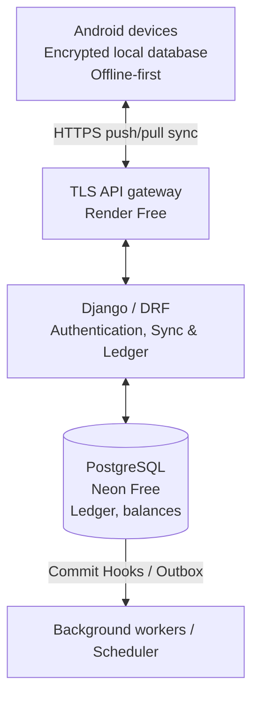

# V2 System Architecture

## Core Topology
The CredKeep V2 platform operates as an offline-first modular monolith built in Django/DRF, backed by PostgreSQL, with the existing React Native mobile application functioning as the edge node. 

## System Responsibilities
1. **Client (React Native):** Maintains the SQLite local ledger. Operates completely offline. Captures collections as 'Pending' until acknowledged by the server.
2. **Gateway:** Terminates TLS, handles rate limiting and payload validation.
3. **Backend (Django):** Enforces tenant isolation, manages the authoritative ledger, and handles the sync protocol via DRF APIs.
4. **Database (PostgreSQL):** Authoritative storage. Enforces financial integrity through constraints, triggers, and Row-Level Security (RLS) for defense-in-depth.

## Component Decisions
- **Tenancy:** Single-lender (1 tenant = 1 user). No complex organizational roles.
- **Encryption:** Standard HTTPS and DB at-rest encryption. Backend can decrypt for validation and reporting.
- **Offline Writes:** Offline receipts are "pending" locally until the server sync confirms allocation.
