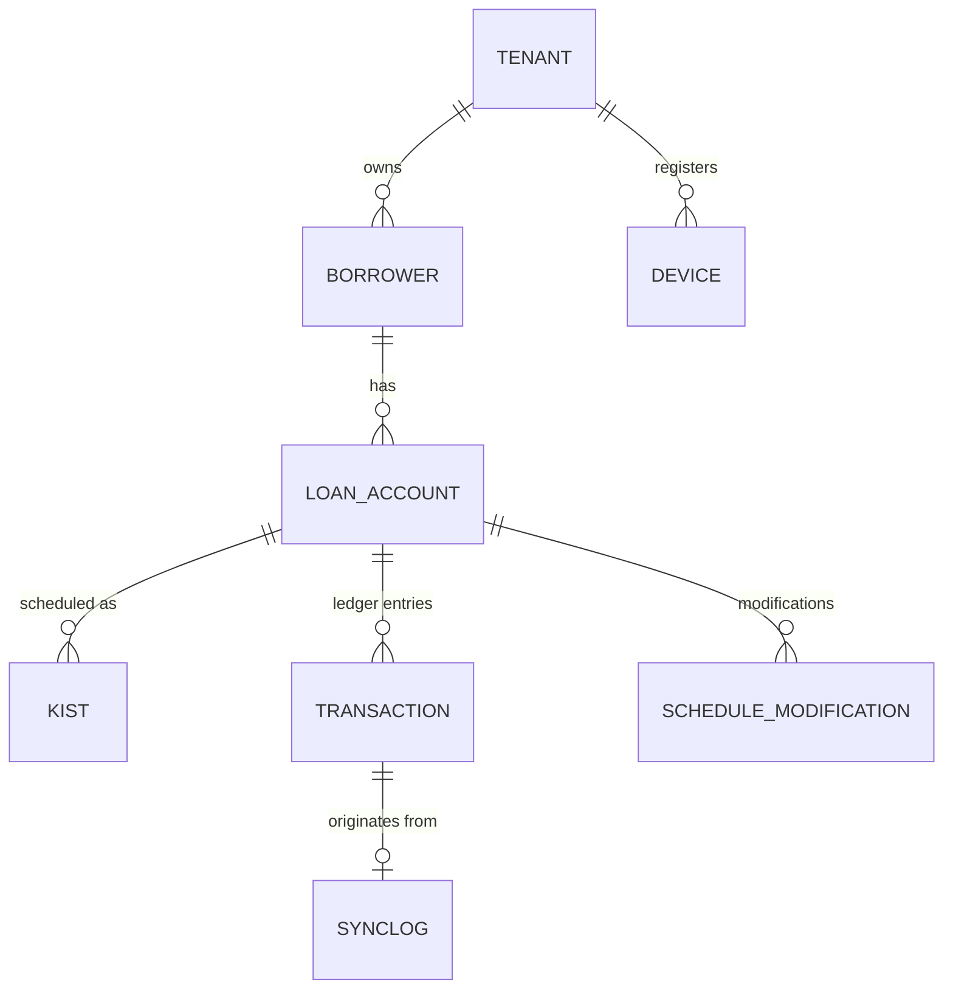

# Data Model

The PostgreSQL database acts as the source of truth. It reflects the mobile SQLite schema while adding multi-tenancy and sync operation tracking.

## Core Models

### 1. Identity & Tenancy
- **User:** Django's built-in Auth User (represents the lender's login).
- **Tenant:** Represents the isolated lender environment (1:1 with User for now).
- **Device:** Represents registered mobile devices (`id`, `tenant_id`, `push_token`, `last_sync`).

### 2. Loan Management
- **Borrower:** `id` (UUID), `tenant_id`, `name`, `phone` (unique per tenant).
- **LoanAccount:** `id` (UUID), `tenant_id`, `borrower_id`, `principal_paise`, `markup_factor`, `term_months`, `start_date`, `due_day`, `product_type`, `status`.
- **Kist (Repayment Schedule):** `id`, `tenant_id`, `loan_id`, `installment_number`, `original_due_date`, `effective_due_date`, `principal_component_paise`, `markup_component_paise`, `total_due_paise`, `principal_paid_paise`, `markup_paid_paise`, `status`.

### 3. Financial Ledger
- **Transaction:** `id`, `tenant_id`, `operation_id` (UUID from client, unique per tenant), `loan_id`, `sequence_number` (auto-increment per tenant), `transaction_type` (COLLECTION, PENALTY_ASSESSMENT), `is_cash`, `amount_paise`, `allocated_principal_paise`, `allocated_markup_paise`, `allocated_penalty_paise`, `unallocated_surplus_paise`, `effective_date`.
- **ScheduleModification:** Tracks explicit changes to due dates or waived penalties.

### 4. Sync Tracking
- **SyncLog:** `id`, `tenant_id`, `device_id`, `operation_id`, `status` (ACCEPTED, REJECTED, NEEDS_REVIEW), `server_timestamp`.
- **SyncOutbox:** Used for tracking changes that need to be pulled by devices.

## Entity-Relationship Diagram

*Note: All monetary values are strictly `INTEGER` representing Paise (1/100 INR).*
